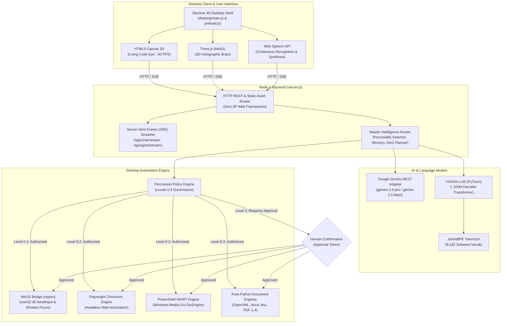

# VISION / JARVIS

> **Multi-Model AI Desktop Automation Assistant**  
> An engineering project combining an independently developed 100M-parameter language model (**VISION**), cloud model orchestration (**Google Gemini**), and a local Windows desktop automation engine (**JARVIS**).

---

## 1. Project Overview

VISION / JARVIS is a unified desktop AI assistant designed for Windows. The project integrates three distinct software engineering domains into a single functional platform:

1. **VISION LLM**: An independently developed, decoder-only autoregressive foundation language model (~100 million parameters) implemented in pure PyTorch (`ml_foundation/`). It includes a custom Byte-Level BPE tokenizer, modern architectural components (RoPE, RMSNorm, GQA, SwiGLU), training pipelines, and local KV-cached inference.
2. **Google Gemini LLM Integration**: A lightweight, zero-dependency HTTPS REST client (`server/aiProviderAdapter.js`) connecting the assistant to Google's Gemini models (`gemini-2.5-pro`, `gemini-2.5-flash`) for deep conversational reasoning, streaming Server-Sent Events (SSE), and structured function calling.
3. **JARVIS Desktop Automation Engine**: A multi-tiered Windows operating system automation framework supporting direct Win32 API calls (`ctypes`), headless browser control (Playwright), hardware-accelerated local OCR (WinRT), pure-Python OpenXML/PDF document generation, and a centralized security permission gate with human-in-the-loop authorization.

---

## 2. System Architecture



For complete technical specifications, see:
- [System Architecture Specification](docs/ARCHITECTURE.md)
- [VISION LLM Specification](docs/VISION_LLM.md)
- [Gemini Integration Specification](docs/GEMINI_INTEGRATION.md)
- [Desktop Automation Specification](docs/DESKTOP_AUTOMATION.md)
- [Complete Technology Stack Audit](TECH_STACK.md)

---

## 3. Key Implemented Features

### Desktop Assistant Interface
- **Frameless Desktop Shell**: Runs via Electron 45 with background wake-word listening, system tray integration, and global hotkeys (<kbd>Ctrl</kbd> + <kbd>Shift</kbd> + <kbd>J</kbd> / <kbd>U</kbd>).
- **Dual Personality Governance**:
  - **JARVIS**: Full personal assistant mode with access to development tools, application launching, document generation, and approved workflows.
  - **ULTRON**: Restricted analytical mode dedicated to system diagnostics, security analysis, and read-only telemetry.
- **60 FPS Procedural Visualizer**: HTML5 Canvas 2D engine (`js/eye.js`) rendering pupil dilation, iris fibers, micro-saccadic eye movement, and background code streams.
- **3D Neural Center**: WebGL Three.js visualizer (`js/modules/brain3DVisualizer.js`) displaying point-cloud cortical hemispheres and synaptic filaments.

### Local Windows Telemetry & Security
- **Hardware Telemetry**: Real-time multi-core CPU utilization (300ms delta), physical RAM, disk space for all logical drives, and top memory-consuming processes.
- **Static Code Vulnerability Analyzer**: AST and regex inspection for SQL injection, command injection, hardcoded credentials, unsafe eval, and path traversal (`server/codeSecurityAnalyzer.js`).
- **Emergency Stop Subsystem**: Global hardware and software kill-switch terminating child processes and locking tool execution (`server/emergencyStopController.js`).

### Automation & Workflows
- **Application Registry & Launcher**: Automatically scans, indexes, and resolves 140+ installed Windows applications with allowlist enforcement (`server/desktop/appLauncher.js`).
- **Win32 Input Injection**: Synthesizes keyboard and mouse events via native Windows `SendInput` with multi-monitor DPI coordinate awareness.
- **Web Intelligence**: Headless web search, article extraction, and live news normalization via Microsoft Playwright.
- **Local OCR**: Offline text recognition directly via Windows Runtime `Windows.Media.Ocr.OcrEngine`.
- **Zero-Dependency Document Generation**: Generates valid Microsoft Word (.docx), Excel (.xlsx), and PDF 1.4 documents using pure-Python standard libraries (`zipfile`, `xml.etree.ElementTree`, `zlib`).

---

## 4. VISION LLM Specification

VISION is an original PyTorch implementation of a decoder-only transformer:

```text
Input Tokens [B, T] -> Embedding (8192, 768) -> 14x Transformer Blocks -> RMSNorm -> LM Head [B, T, 8192]
```

### Architectural Parameters (100M Baseline)

| Parameter | Configuration | Technical Rationale |
| :--- | :--- | :--- |
| **Model Size** | $\approx 98.3\text{M parameters}$ | Optimal capacity for local CPU/GPU research exploration |
| **Hidden Dimension ($d_{model}$)** | 768 | Divisible by 12 attention heads ($head\_dim = 64$) |
| **Layers ($n_{layers}$)** | 14 | Balanced depth for feature hierarchy and execution speed |
| **Attention Heads ($n_{heads}$)** | 12 (Query), 4 (Key/Value) | Grouped-Query Attention (GQA) reduces KV-cache memory by 66% |
| **FFN Intermediate ($d_{ff}$)** | 2,048 | SwiGLU non-linear expansion |
| **Positional Encoding** | RoPE ($\theta = 10000.0$) | Relative positional representation across variable sequence lengths |
| **Normalization** | RMSNorm ($\epsilon = 10^{-5}$) | Faster training throughput and numerical stability compared to LayerNorm |
| **Tokenizer** | JarvisBPE (8,192 vocab) | Deterministic Byte-Level BPE preserving identifiers and Devanagari Hindi |

For mathematical parameter derivations and training configuration, see [VISION_LLM.md](docs/VISION_LLM.md).

---

## 5. Google Gemini API Integration

The assistant uses Google Gemini models for cloud-assisted conversational reasoning and function execution:

- **Protocol**: Direct Node.js `https.request` calls to `generativelanguage.googleapis.com` without external SDKs.
- **Streaming**: Server-Sent Events (SSE) deliver incremental tokens to the client with sub-100ms first-token latency.
- **Tool Calling**: Function call signatures are declared in request payloads; returned tool invocations are routed through the central `PermissionGate`.
- **Credential Protection**: Keys are loaded via `.env` and automatically redacted from error ledgers and audit logs.

For request schemas and dispatch details, see [GEMINI_INTEGRATION.md](docs/GEMINI_INTEGRATION.md).

---

## 6. Desktop Automation & Security Governance

Every desktop tool action is evaluated against a strict multi-tier security policy (`server/security/permissionPolicyEngine.js`):

- **Level 0 (Read-Only)**: System telemetry, directory listing, clock, timers. Automatically allowed.
- **Level 1 (Reversible Local)**: Temporary scratchpad file creation. Automatically allowed.
- **Level 2 (Standard Controlled)**: Launching allowlisted desktop applications (`code`, `notepad`, `chrome`, `calc`).
- **Level 3 (Sensitive / Destructive)**: **File deletion outside `scratch/`**, sending external messages, code modifications. **Requires explicit single-use cryptographic approval tokens.**
- **Level 4 (Prohibited)**: System file modification, disk formatting, sandbox escape. **Strictly denied under all circumstances.**

For security policies and shell allowlist patterns, see [DESKTOP_AUTOMATION.md](docs/DESKTOP_AUTOMATION.md).

---

## 7. Technology Stack Summary

| Layer | Technologies | Verification Status |
| :--- | :--- | :---: |
| **Core Languages** | JavaScript (ES2022+), Python 3.12, HTML5 / CSS3, PowerShell | Verified |
| **AI / ML Framework** | PyTorch (`torch==2.15.0+cpu`), SymPy, Scikit-Learn, SciPy | Verified |
| **Cloud AI** | Google Gemini REST API (`gemini-2.5-pro`, `gemini-2.5-flash`) | Verified |
| **Desktop Automation** | Win32 API (`ctypes`), Microsoft Playwright, WinRT OCR, Pillow | Verified |
| **Document Generation** | Pure-Python OpenXML (.docx/.xlsx) and PDF 1.4 engines | Verified |
| **Backend Runtime** | Node.js Built-in `http`, Server-Sent Events (SSE) | Verified |
| **Desktop Container** | Electron 45 (`desktop/main.js`, `desktop/preload.js`) | Verified |
| **Frontend Visuals** | HTML5 Canvas 2D, Three.js (WebGL), Web Speech API | Verified |
| **Storage & State** | File-system JSON/JSONL, `numpy.memmap` binary token shards | Verified |

Detailed line counts, AST imports, and package analyses are documented in [TECH_STACK.md](TECH_STACK.md).

---

## 8. Installation & Setup

### Prerequisites

- **Operating System**: Windows 10 or Windows 11 (64-bit).
- **Node.js**: v18.0.0 or higher (v22+ recommended).
- **Python**: v3.12.x with `pip` and virtual environment support.

### Step 1: Clone the Repository

```bash
git clone https://github.com/Lokeshcodex-rbg/VISION-JARVIS.git
cd VISION-JARVIS
```

### Step 2: Install Node.js Dependencies

```bash
npm install
```

### Step 3: Setup Python Virtual Environment

```bash
python -m venv .venv
.\.venv\Scripts\activate
pip install -r requirements.txt
```

### Step 4: Configure Environment Variables

Copy the provided `.env.example` template to `.env`:

```bash
cp .env.example .env
```

Edit `.env` and provide your Google Gemini API key:

```ini
PORT=3000
AI_PROVIDER=gemini
GEMINI_API_KEY=your_actual_gemini_api_key_here
```

*(Note: If no API key is provided, all offline tools, hardware diagnostics, and document generators remain fully functional).*

---

## 9. Running the Application

### Option A: Windows Desktop Application (Recommended)

Launches the backend server and opens the frameless Electron desktop companion:

```bash
npm start
```

### Option B: Headless Server / Browser Companion

Runs the Node.js server independently at `http://localhost:3000`:

```bash
npm run server
```

### Desktop Controls & Hotkeys

| Shortcut | Action |
| :--- | :--- |
| <kbd>Ctrl</kbd> + <kbd>Shift</kbd> + <kbd>J</kbd> | Global hotkey: Activate Assistant Primary Mode |
| <kbd>Ctrl</kbd> + <kbd>Shift</kbd> + <kbd>U</kbd> | Global hotkey: Activate Assistant Extended Mode |
| <kbd>Escape</kbd> | Dismiss interface to system tray |
| <kbd>M</kbd> | Toggle between UI color themes and modes |
| <kbd>S</kbd> | Silence active speech immediately |
| <kbd>F</kbd> | Toggle fullscreen mode |

---

## 10. Running Tests & Model Verification

### Run the Master End-to-End Regression Suite (Workstreams A–J)

```bash
npm test
```

### Run VISION Foundation Model Unit Tests

```bash
.\.venv\Scripts\python.exe tests/test_vision_v08_foundation.py
```

### Run Conversational Memory & Planning Tests

```bash
node tests/test_v13_memory_system.js
node tests/test_v13_planning_engine.js
```

---

## 11. Known Technical Limitations

1. **Training Compute Scale**: The VISION LLM is an independent research implementation developed and evaluated on consumer hardware. Pretraining runs have been conducted on targeted curricula (tens of millions of tokens) rather than industrial web-scale corpora.
2. **CPU Inference Latency**: Autoregressive decoding on consumer CPUs scales with sequence length. While KV-caching provides steady token intervals, large sequence generation is best suited for GPU execution.
3. **OS-Specific Desktop Automation**: Desktop automation components (Win32 `ctypes`, WinRT OCR, PowerShell COM automation) are designed specifically for Microsoft Windows and require adaptation for POSIX environments.

---

## 12. Future Roadmap

- [ ] **Distributed GPU Pretraining**: Finalize FSDP (Fully Sharded Data Parallel) multi-GPU pretraining scripts for scaling VISION to 250M+ parameters.
- [ ] **Cross-Platform OS Abstraction**: Implement modular display and input abstractions for Linux (X11/Wayland) and macOS.
- [ ] **Local Small-Model Routing**: Enable seamless speculative decoding between local VISION LLM weights and cloud Gemini models.

---

## 13. License

This project is licensed under the MIT License — see the [LICENSE](LICENSE) file for details.
