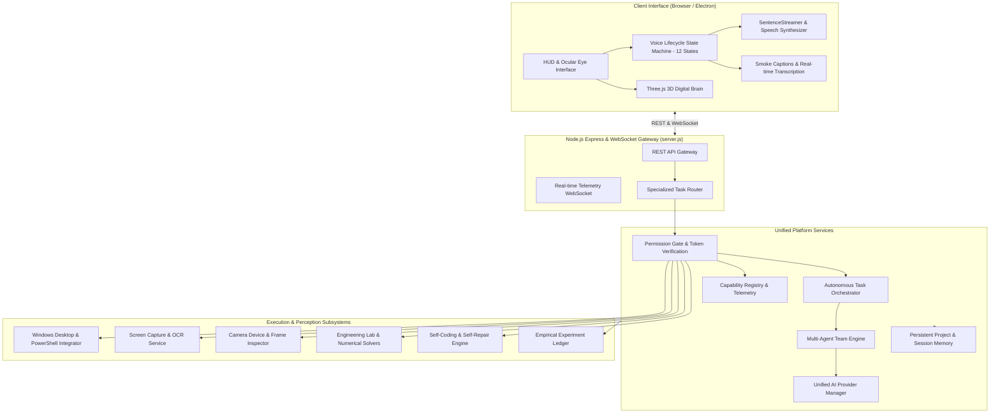
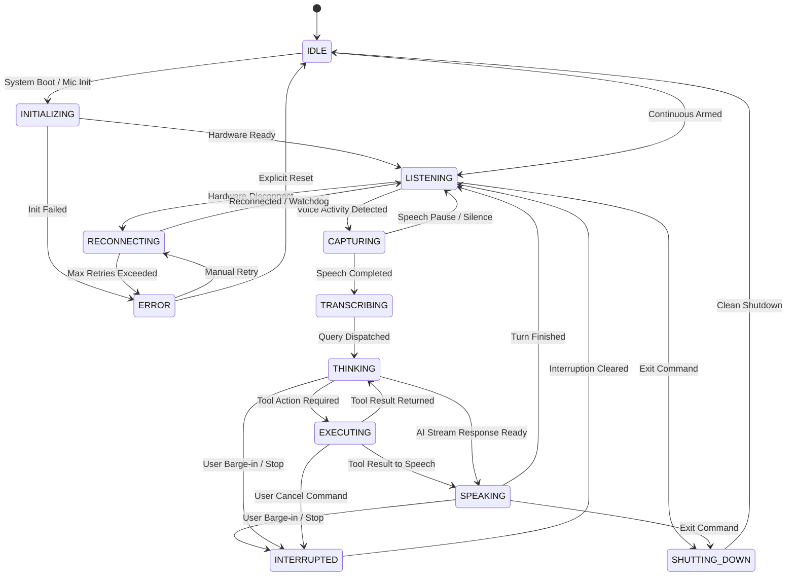
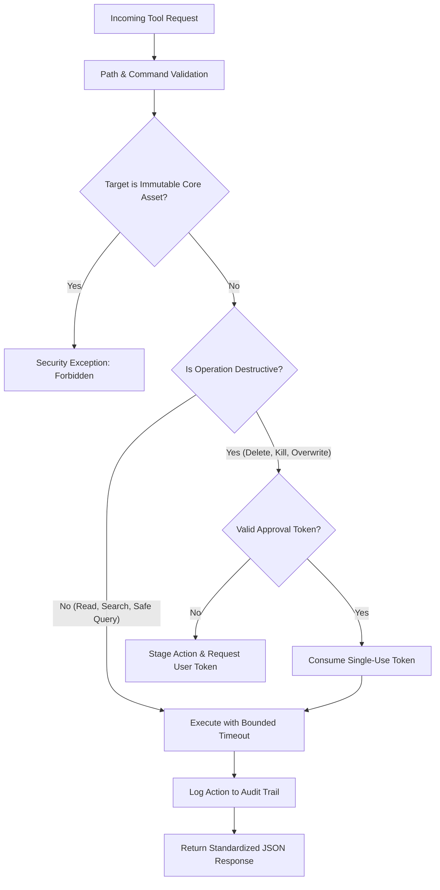

# VISION AI (MADE BY LOKESH) — System Architecture & Component Topology

**Document Version:** 2.0.0  
**Project Directory:** `D:\Jarvis`  
**Primary Engine:** Dual-Persona Intelligence Platform (JARVIS & ULTRON)  

---

## 1. High-Level System Architecture

VISION AI (MADE BY LOKESH) is designed as a modular, low-latency, resilient desktop intelligence system combining real Windows operating system control, multimodal perception, voice conversation, engineering computation, and autonomous multi-agent task execution.

---

## 2. Voice Conversational State Machine (Part 3.1)

The client-side voice lifecycle in [`js/modules/conversationSessionManager.js`](file:///d:/Jarvis/js/modules/conversationSessionManager.js) implements an authoritative, event-driven state machine governing the voice interaction cycle across **12 canonical explicit states**:

### Stale Event Rejection & Watchdogs

1. **Turn Generation Validation:** Every transition metadata object includes a `turnId`. If an asynchronous callback arrives with an outdated `turnId`, it is safely discarded, preventing obsolete responses from overwriting a newer turn.
2. **Anti-Hang Watchdogs:**
   - `THINKING` state has a 35s auto-recovery watchdog returning to `LISTENING`.
   - `EXECUTING` state has a 60s auto-recovery watchdog returning to `LISTENING`.
   - `SPEAKING` state has a 45s auto-recovery watchdog returning to `LISTENING`.
   - `RECONNECTING` state has a 6s watchdog preventing infinite reconnection loops.

---

## 3. Unified Intelligence Architecture (Part 2 & Part 4)

Both **JARVIS** and **ULTRON** operate on top of a single, shared intelligence stack:

- **Shared Provider Manager:** Centralizes calls to Gemini models (`gemini-2.5-flash`, `gemini-1.5-pro`) and local fallback heuristics.
- **Shared Memory:** Conversation history, project context, and user preferences are preserved across personality switches.
- **Shared Tool Registry:** Desktop automation, file management, engineering calculations, and research tools are universally accessible to both personas.
- **Differentiated Personas:**
  - **JARVIS:** Composed, articulate, concise British-English tone, constructive suggestions, and proactive assistance.
  - **ULTRON:** Strategic, deliberate, adversarial review, critical threat modeling, and red-team design critique.

---

## 4. Real Computer Control & Safety Gateway (Part 5 & Part 18)

Windows automation is mediated by [`server/desktop/permissionGate.js`](file:///d:/Jarvis/server/desktop/permissionGate.js):

### Inviolable Security Core

The following files cannot be altered, overwritten, or bypassed by self-coding, autonomous tasks, or multi-agent engines:

- `server/desktop/permissionGate.js`
- `server/capabilityRegistry.js`
- `server/selfDevelopmentEngine.js`
- `server/selfRepairService.js`

---

## 5. Engineering Laboratory & Numerical Solvers (Part 13)

The engineering lab at [`server/engineeringLab.js`](file:///d:/Jarvis/server/engineeringLab.js) provides closed-form mathematical analysis and parametric CAD synthesis:

- **Structural Analysis:** Euler-Bernoulli beam deflection and bending stress solver.
- **Mechatronics & Actuation:** Motor torque sizing, gear ratios, and angular acceleration budgets.
- **CAD Generation:** Constructive Solid Geometry (CSG) parametric script generation for OpenSCAD.
- **Technical Reproduction:** Automatic LaTeX and Node.js CLI script generation for transparent validation.

---

## 6. Multi-Agent Team Engine (Part 10)

The multi-agent system at [`server/agentTeam.js`](file:///d:/Jarvis/server/agentTeam.js) provides task specialization under unified policy governance:

- **Orchestrator Agent:** Decomposes complex directives into atomic subtasks.
- **Researcher Agent:** Gathers and synthesizes technical documentation and sources.
- **Programmer & Code Reviewer Agents:** Generates diffs and conducts static analysis.
- **Tester & Verifier Agents:** Executes automated test scripts and validates empirical outputs.
- **Specialist Engineering Agents:** Evaluates structural, electrical, and robotic constraints.
