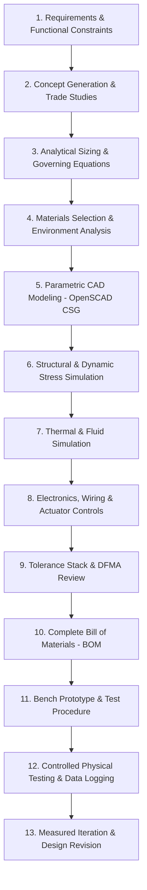

# STARK AI — Advanced Engineering Design, Parametric CAD & Simulation Lab

**Document Version:** 3.0.0  
**Project Workspace:** `D:\Jarvis`  
**Classification:** Engineering Lifecycle Management, Parametric 3D CAD & Virtual Simulation  

---

## 1. Unified 13-Stage Engineering Pipeline

STARK AI structures every engineering study, mechanical design, and prototype through an authoritative 13-stage disciplined progression:



Every project record tracks:

- **Traceability:** Requirements $\to$ Equations $\to$ CAD $\to$ Simulation $\to$ Test Outcome.
- **Safety Gating:** High-energy or wearable projects enforce mandatory bench testing before physical assembly.

---

## 2. Parametric 3D OpenSCAD Model Generation

Implemented in [server/mechanicalRoboticsEngine.js](file:///d:/Jarvis/server/mechanicalRoboticsEngine.js):

### 2.1 Pure CSG Parametric Synthesis

When external CAD binaries (`openscad.exe`) are absent from the host `PATH`, the platform engages pure Constructive Solid Geometry (CSG) synthesis:

- Generates clean, human-readable, parameterized `.scad` scripts.
- Parameters define major dimensions (length, width, wall thickness, bore diameter, bolt hole pitch).
- Validates manifold syntax and watertight geometries in-engine.
- Delivers exportable scripts that can be opened and compiled in any external OpenSCAD or CAD suite.

### 2.2 Robotic Linkage & Bracket Geometry

Example generated OpenSCAD artifact for a 2-DOF robotic linkage bracket:

```openscad
// STARK AI Generated Parametric Robotic Joint Bracket
// Material: Aluminum 6061-T6 | Safety Factor: 2.1
$fn = 60;
arm_length = 180.0;
bracket_width = 45.0;
wall_thickness = 4.5;
bore_motor_shaft = 8.0;
mounting_hole_pitch = 28.0;
bolt_dia = 3.2;

difference() {
    union() {
        cube([arm_length, bracket_width, wall_thickness], center=false);
        cylinder(r=bracket_width/2, h=wall_thickness*2);
        translate([arm_length, bracket_width/2, 0])
            cylinder(r=bracket_width/2, h=wall_thickness*2);
    }
    // Motor shaft pass-through
    translate([0, bracket_width/2, -1])
        cylinder(r=bore_motor_shaft/2, h=wall_thickness*2 + 2);
    // Bolt pattern
    for (i = [0:3]) {
        rotate([0, 0, i * 90])
            translate([mounting_hole_pitch/2, 0, -1])
                cylinder(r=bolt_dia/2, h=wall_thickness*2 + 2);
    }
}
```

---

## 3. Bill of Materials (BOM) & Cost Estimation

Every engineering study produces a complete, itemized Bill of Materials:

- **Part Number & Component Description:** Sourced standard hardware (bearings, fasteners, motors, ESCs, sensors) alongside custom fabricated linkages.
- **Material & Manufacturing Method:** CNC milled aluminum, 3D printed PETG/nylon, sheet metal laser cut, or composite layup.
- **Supplier & Lead Time Estimates:** Digikey, McMaster-Carr, LDO Motors, or local stock.
- **Unit & Total Project Cost:** Itemized hardware expenses and mass roll-up.

---

## 4. Active Engineering Study Blueprints

The platform maintains comprehensive project blueprints in [server/mechanicalRoboticsEngine.js](file:///d:/Jarvis/server/mechanicalRoboticsEngine.js):

1. **`proj_robotic_arm_3dof`:** 3-DOF Desktop Robotic Manipulator (Payload: 0.8kg, Reach: 420mm, Brushless direct-drive with planetary reducers).
2. **`proj_wearable_robotic_arm`:** Assistive Upper-Limb Robotic Exoskeleton (Human elbow/shoulder torque assistance, lightweight carbon-fiber/aluminum hybrid, mechanical emergency release).
3. **`proj_quadruped_leg_module`:** High-Dynamic Robotic Leg Actuator (Quasi-direct drive brushless outrunner, high torque density, back-drivable compliance).
4. **`proj_drone_propulsion_rig`:** Drone & eVTOL Propulsion Test Stand (Load-cell thrust and torque measurement, optical RPM tachometer, electrical power analyzer).
5. **`proj_ironman_hud_optics`:** Augmented Reality Optical Waveguide Concept (Waveguide prism simulation, eyebox analysis, thermal management for micro-OLED display).
6. **`proj_bipedal_balance_testbed`:** Inverted Pendulum Dynamic Balance Controller (Reaction wheel dynamic torque compensation, IMU Kalman filter state estimation).
7. **`proj_evtol_hover_testbed`:** Coaxial Dual-Rotor eVTOL Hover Dynamics (Thrust-to-weight ratio, battery C-rate discharge, differential yaw control).
