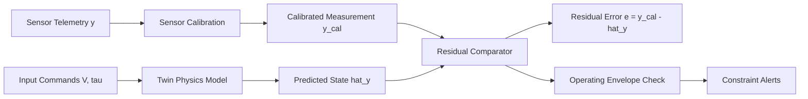

# STARK AI — Automated Design Optimization & Live Digital Twins Guide

**Document Version:** 4.0.0  
**Project:** STARK AI / JARVIS (`D:\Jarvis`)  
**Scope:** Multi-Objective Pareto Optimization, Parameter Sweeps, Finite-Difference Sensitivity, TOPSIS Decision Ranking, and Live Digital Twin Telemetry Synchronization  

---

## 1. Overview

STARK AI bridges theoretical mechanics with empirical observations through:

1. **Automated Engineering Design Exploration (`server/designExplorationEngine.js`):** Multi-objective genetic optimization, non-dominated sorting (Pareto front), parameter sweeps, sensitivity partial derivatives, and multi-criteria decision analysis.
2. **Live Digital Twins (`server/digitalTwinEngine.js`):** Real-time ODE dynamics models synchronized with sensor telemetry, computing prediction residuals ($e = y_{meas} - \hat{y}_{pred}$), detecting operating envelope violations, calibrating sensor zero-offsets, and replaying historical traces.

---

## 2. Automated Engineering Design Exploration

### 2.1 Multi-Objective Beam Optimization Example

Consider a hollow rectangular wing spar or robotic arm link:

- **Design Variables:**
  - `widthMm`: Outer width [30mm – 80mm]
  - `heightMm`: Outer height [50mm – 140mm]
  - `wallThicknessMm`: Wall thickness [2mm – 8mm]
  - `materialGrade`: `AL_6061`, `TI_6AL_4V`, or `CFRP`
- **Competing Objectives:**
  1. Minimize Structural Mass ($m = \rho \cdot V$)
  2. Minimize Material Cost ($C = m \cdot c_{mat}$)
  3. Maximize Factor of Safety ($\text{FOS} = \sigma_{yield} / \sigma_{bending}$)
- **Engineering Constraints:**
  - $\text{FOS} \ge 1.5$
  - Tip Deflection $\delta \le 10.0\text{ mm}$
  - Mass $m \le 8.0\text{ kg}$

### 2.2 Generating the Non-Dominated Pareto Front

A candidate design $A$ dominates design $B$ if $A$ is no worse than $B$ in all objectives and strictly superior in at least one objective.

```javascript
const { designExplorationEngineInstance } = require('./server/designExplorationEngine.js');

const exploration = designExplorationEngineInstance.exploreParetoFront({
  sampleCount: 100,
  requirements: { minFos: 1.5, maxDeflectionMm: 10.0, maxMassKg: 8.0 },
  materials: ['AL_6061', 'TI_6AL_4V', 'CFRP']
});

console.log(`Feasible Designs: ${exploration.feasibleCount}`);
console.log(`Pareto Front Size: ${exploration.paretoFrontCount}`);
// Returns sorted non-dominated Pareto front candidates
```

### 2.3 Finite-Difference Sensitivity Analysis

Computes local partial derivatives using central finite differences:
$$\frac{\partial \text{Objective}_i}{\partial \text{Var}_j} \approx \frac{f(x_j + \Delta) - f(x_j - \Delta)}{2\Delta}$$

```javascript
const sensitivity = designExplorationEngineInstance.calculateSensitivity({
  widthMm: 50,
  heightMm: 100,
  wallThicknessMm: 4,
  materialGrade: 'AL_6061'
});

console.log(sensitivity.sensitivities.heightMm);
// {
//   dMassDVar: 0.0432,
//   dDeflectionDVar: -0.1245,
//   dFosDVar: 0.0812,
//   interpretation: 'Increasing heightMm increases FOS by 0.81 per 10mm...'
// }
```

### 2.4 TOPSIS Multi-Criteria Decision Ranking

Ranks Pareto-front candidates according to user preference weights:

- Mass Weight: 0.40
- Cost Weight: 0.30
- Factor of Safety Weight: 0.30

```javascript
const ranked = designExplorationEngineInstance.rankParetoDesigns(
  exploration.paretoFront,
  { mass: 0.4, cost: 0.3, fos: 0.3 }
);

console.log(`Top Candidate Score: ${ranked[0].compositeScore}`);
console.log(`Recommendation: ${ranked[0].rankingRationale}`);
```

---

## 3. Live Digital Twins & Sensor Synchronization

### 3.1 Digital Twin Architecture

A digital twin maintains:

1. **Parameters:** Physical constants (phase resistance $R$, torque constant $K_t$, rotor inertia $J$, thermal resistance $R_{th}$).
2. **Operating Envelope:** Hard physical safety thresholds (max current, max temperature, max stress).
3. **Calibration State:** Sensor zero-offsets and scale factors.
4. **Predicted State:** Synchronously stepped forward via ODE/physics equations.
5. **Residuals:** $e_k = y_{k, measured} - \hat{y}_{k, predicted}$.



### 3.2 Brushless DC Motor Twin Execution Example

```javascript
const { digitalTwinEngineInstance } = require('./server/digitalTwinEngine.js');

// Step simulation and ingest telemetry
const result = digitalTwinEngineInstance.syncStep('twin_bldc_actuator_01', {
  voltageInputV: 24.0,
  loadTorqueNm: 0.4
}, {
  currentAmps: 5.8,
  rpm: 2450,
  tempCelsius: 38.5,
  provenance: 'PHYSICAL_SENSOR'
}, 0.02);

console.log(result.status); // 'SYNCHRONIZED_NORMAL'
console.log(result.frame.predicted);
// { currentAmps: 5.82, rpm: 2465, tempCelsius: 38.2, grounding: 'SIMULATED' }
console.log(result.frame.residuals);
// { currentResidualAmps: -0.02, rpmResidual: -15, tempResidualCelsius: 0.3 }
```

### 3.3 Operating Envelope Constraint Violations

If telemetry indicates that operating conditions exceed structural or thermal ratings:

```javascript
const violation = digitalTwinEngineInstance.syncStep('twin_bldc_actuator_01', {
  voltageInputV: 48.0
}, {
  currentAmps: 42.0, // Limit: 35.0 A
  tempCelsius: 102.0 // Limit: 95.0 C
});

console.log(violation.status); // 'CONSTRAINT_VIOLATION'
console.log(violation.frame.violations);
// [
//   { constraint: 'maxCurrentAmps', limit: 35.0, measured: 42.0 },
//   { constraint: 'maxTempCelsius', limit: 95.0, measured: 102.0 }
// ]
```

### 3.4 Sensor Zero-Offset Calibration

```javascript
const calibrationData = [
  { measuredRaw: 0.048, expectedTrue: 0.0 },
  { measuredRaw: 0.052, expectedTrue: 0.0 },
  { measuredRaw: 0.050, expectedTrue: 0.0 }
];

const calibRes = digitalTwinEngineInstance.calibrateSensors('twin_bldc_actuator_01', calibrationData);
console.log(`Estimated Mean Zero Offset: ${calibRes.estimatedMeanOffset} A`);
```

### 3.5 Telemetry Trace Replay

Recorded mission traces can be replayed to recreate dynamic events, isolate sensor anomalies, or debug mechanical faults post-mortem:

```javascript
const replay = digitalTwinEngineInstance.replayTrace('twin_bldc_actuator_01', savedTraceFrames);
console.log(`Replayed ${replay.replayedCount} frames with ${replay.anomaliesInTrace} anomalies detected.`);
```
