# STARK AI — Knowledge Acquisition, Research & Causal World Model Engine

**Document Version:** 3.0.0  
**Project Workspace:** `D:\Jarvis`  
**Classification:** Continuous Scientific Research, Literature Verification & Knowledge Graph Topology  

---

## 1. Grounding Philosophy & Evidence Classification

STARK AI adheres strictly to an honest epistemology: **Never fabricate a scientific breakthrough, preprint, publication, or citation.** Information is never treated as universally absolute; instead, every proposition, fact, or metric is tagged with its origin, timestamp, retrieval date, and evidential tier.

### Evidential Classification Tiers

1. **Peer-Reviewed Experimental Evidence:** Documented empirical data from recognized peer-reviewed literature or validated laboratory measurements.
2. **Preprint / Preliminary Research:** Un-refereed scientific papers (e.g. ArXiv, bioRxiv) containing explicit methods, authors, and dates.
3. **Official Technical Documentation:** Datasheets, hardware manuals, programming guides, and standard specification sheets from manufacturers or standards bodies.
4. **Reputable Secondary Reporting:** Technical journalism and curated summaries from identifiable technical publications.
5. **Analytical / Theoretical Inference:** Mathematical derivations and physical equations solved in-process by the platform's solvers.
6. **Unverified Claim / Speculation:** External assertions lacking experimental backing, identified with transparent epistemic disclaimers.

---

## 2. Pluggable Scientific Research Connectors

Implemented in [server/advancedResearchEngine.js](file:///d:/Jarvis/server/advancedResearchEngine.js):

### 2.1 ArXiv Scholarly Research Engine

- **Endpoint:** `https://export.arxiv.org/api/query`
- **Methodology:** Fetches real academic preprints across computer science, physics, robotics, mathematics, and electrical engineering.
- **Parsing:** Extracts structured metadata: title, authors, DOI/ArXiv ID, publication timestamp, and verified abstract.
- **Caching:** In-memory LRU cache with a 30-minute TTL to respect upstream rate limits while delivering sub-second repeated queries.

### 2.2 DuckDuckGo Live Technical Intelligence

- **Endpoint:** `https://html.duckduckgo.com/html`
- **Zero-Key Architecture:** Operates without requiring proprietary third-party search API keys.
- **Privacy Enforcement:** Strips tracking cookies and user identifiers. Extracts page titles, source URLs, and contextual technical snippets.

### 2.3 Conflicting Source Comparison Engine

When researching rapidly evolving topics (e.g. battery chemistry, eVTOL noise regulations, humanoid actuator efficiency), the platform compares multiple claims side-by-side:

- **Direct Evidence vs. Theoretical Speculation:** Separates measured bench data from forward-looking modeling claims.
- **Methodological Assumptions:** Highlights discrepancies in testing conditions (e.g. ambient temperature, C-rate, payload mass).
- **Consensus Synthesis:** Delivers a balanced summary identifying points of agreement and unresolved technical debates.

---

## 3. Persistent Local Knowledge Base

Stores verified research entries locally in `data/knowledge_base/entries.json`:

- **Unique Entry ID:** Hash-based identifier (`kb_<timestamp>_<random>`).
- **Semantic Tags:** Cross-cutting indexing (e.g. `#robotics`, `#actuators`, `#materials`, `#aerospace`).
- **Provenance Attributes:** Source URL, retrieval date, authoring institution, publication date, and confidence rating (0.0 to 1.0).
- **Inspectability & Deletion:** User has complete programmatic control to inspect, export, correct, or delete any indexed knowledge entry.

---

## 4. Causal World Model & Knowledge Graph Topology

Implemented in [server/knowledgeGraphEngine.js](file:///d:/Jarvis/server/knowledgeGraphEngine.js):

The Knowledge Graph represents entities, physical properties, dependencies, and causal relationships as a directed graph $G = (V, E)$:

```mermaid
graph LR
    Motor[BLDC Motor: T-Motor U8 II] -->|generates| Torque[Peak Torque: 4.8 Nm]
    Torque -->|drives| Gearbox[Planetary Reducer: 50:1 Ratio]
    Gearbox -->|multiplies to| JointTorque[Joint Torque: 216 Nm @ 90% Eff]
    JointTorque -->|articulates| Link[Robotic Arm Link: 6061-T6 Aluminum]
    Link -->|experiences| Stress[Bending Stress: 142 MPa]
    Stress -->|evaluated against| YieldStrength[Yield Strength: 276 MPa]
    YieldStrength -->|yields| SafetyFactor[Structural Safety Factor: 1.94]
    
    Battery[LiPo Battery 6S: 22.2V 5000mAh] -->|powers| ESC[Motor Driver ESC: 40A Continuous]
    ESC -->|draws| Current[Peak Current Draw: 32A]
    Current -->|causes| VoltageSag[Battery Voltage Sag: ~1.8V]
    VoltageSag -->|degrades| PeakPower[Available Electrical Power: 652W]
```

### 4.1 Causal Consequence Analysis

When the user proposes a design change (e.g. *"What happens if we increase motor torque by 30%?"*), the engine traverses downstream causal paths:

1. **Actuator Sizing:** Calculates resulting output torque $\tau_{out} = \tau_{in} \cdot N \cdot \eta$.
2. **Structural Load:** Propagates force to connected linkages; computes new bending stress $\sigma = \frac{M \cdot c}{I}$.
3. **Safety Margin:** Re-evaluates factor of safety $FoS = \frac{\sigma_{yield}}{\sigma_{max}}$. Warns if $FoS < 1.5$.
4. **Electrical Power & Thermal Budget:** Computes updated current draw $I = \frac{P}{V}$ and $I^2 R$ winding resistive heat dissipation. Identifies potential thermal throttling or battery voltage sag.

### 4.2 Engineering Decision & Failure Tracking

The graph permanently indexes project decisions and historical experiment outcomes:

- **Decision Records:** Context, alternatives considered, chosen path, trade-offs, and authorizing engineer.
- **Failure Records:** Component tested, failure mode (e.g. thermal shutdown, structural buckling, harmonic resonance), root cause analysis, and preventative design updates.

---

## 5. Long-Term Conversational Memory

Implemented in [server/memoryManager.js](file:///d:/Jarvis/server/memoryManager.js):

- **Category Partitioning:** `preference` (communication style, verbosity), `project` (ongoing software and hardware missions), `learning` (active study topics), `workflow` (preferred tools, paths), and `fact` (user-authorized personal context).
- **Credential Protection:** Hardcoded regex blocks passwords, API keys, tokens, and private credentials from entering long-term memory.
- **Relevance-Driven Retrieval:** Injects only contextually relevant memories into active conversation turns, preserving token budgets and keeping response latency minimal.
