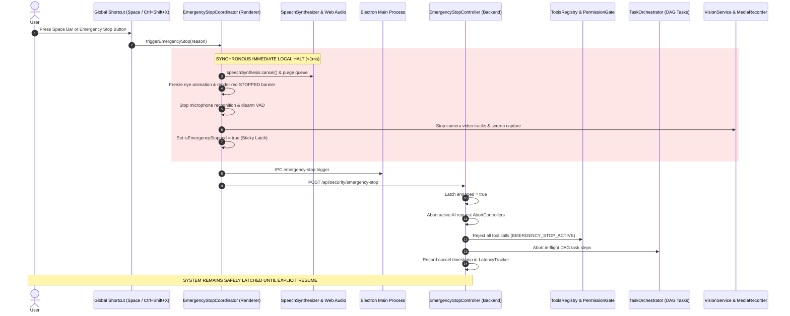

# STARK AI — Master System Architecture & Engineering Topology

**Document Version:** 3.0.0  
**Project Workspace:** `D:\Jarvis`  
**Primary Engines:** Dual-Persona Intelligence Platform (JARVIS & ULTRON)  
**Classification:** Autonomous Personal Engineering Partner, Universal Knowledge Engine & Desktop Assistant  

---

## 1. High-Level Architectural Vision

STARK AI is structured as a unified, resilient, voice-first desktop operating system and engineering laboratory inspired by JARVIS from *Iron Man*. Rather than a collection of disjointed mockups or simple chatbots, it implements an end-to-end cognitive topology combining:

1. **Ultra-Low-Latency Conversational Voice Pipeline:** Continuous Web Audio / VAD streaming, sentence-chunked streaming speech synthesis, instant local routing (<4ms), and token-by-token progressive smoke captions (<26ms).
2. **Centralized Emergency Stop & Safety Latch:** Synchronous local audio silencing (<1ms), active task/tool aborts, vision/mic disarming, and non-overridable latching independent of external AI providers.
3. **Real Windows Operating System Autonomy:** Direct desktop control, window focus, process execution, application management (WhatsApp, Chrome, VS Code, Explorer, Settings), and sandboxed file management.
4. **Physical Vision & Perception Subsystem:** Live camera hardware enumeration, multi-frame differential analysis, screen capture, OCR, and owner identity authentication with privacy lock.
5. **Universal Physics, Mathematics & Engineering Lab:** Exact numerical solvers (RK4, Simpson's, Newton-Raphson, Monte Carlo), classical mechanics, thermodynamics, electromagnetism, aerodynamics, and parametric OpenSCAD CAD synthesis.
6. **Continuous Scientific Research Engine:** Live ArXiv API integration, citation and provenance tracking, conflicting source comparison, and local persistent knowledge indexing.
7. **Autonomous Software Engineering & Self-Repair:** Repository dependency mapping, atomic file patching, optimism concurrency hashing, automated test generation, isolated staging, and automatic rollback.
8. **Multi-Agent Specialist Teams:** Role-based delegation (Research Scientist, Math Solver, Mechanical Engineer, Aerospace Engineer, Software Developer, Security Reviewer) with conflict detection.
9. **3D Neural Core & Truthful Telemetry:** Three.js animated ocular HUD and brain visualizer connected to live hardware and subsystem metrics without fabricated telemetry.

```mermaid
graph TB
    subgraph Client ["Client Interface (Electron Renderer / Browser HUD)"]
        HUD[Living Code Eye Canvas & Ocular HUD]
        DigitalBrain[Three.js 3D Neural Point Cloud]
        SmokeCaptions[Smoke Captions & Token Streamer]
        VoiceCtrl[VoiceController & VAD State Machine]
        TTS[SpeechSynthesizer & Sentence Chunk Queue]
        StopCoord[EmergencyStopCoordinator - Immediate Local Halt]
    end

    subgraph DesktopMain ["Electron Main Process (desktop/main.js)"]
        GlobalHotkeys[Global Shortcut: Ctrl+Shift+X / Space]
        TrayMenu[Native Windows System Tray Controller]
        IPCBridge[Main-Renderer Local IPC Coordination]
    end

    subgraph ServerGateway ["Node.js Server Gateway (server.js - Port 3000)"]
        REST[REST API Endpoints: /api/...]
        SSE[Server-Sent Events: Streaming Tokens & Audio]
        WS[Real-Time Subsystem Telemetry Bus]
    end

    subgraph CorePlatform ["Unified Cognitive Core (server/)"]
        AIAdapter[AIProviderAdapter - Gemini & OpenRouter Tiering]
        ToolsReg[Standardized ToolsRegistry - 65+ Validated Tools]
        PermGate[PermissionGate - Dual Policy & Single-Use Tokens]
        StopCtrl[EmergencyStopController - Central Latch & Tool Aborts]
        TaskOrch[TaskOrchestrator - Autonomous DAG Execution]
        MemMgr[MemoryManager - Semantic Preference Retrieval]
        TimeSvc[TimeService - Deterministic Clock & Multilingual Greetings]
        LangMgr[LanguageVoiceManager - English, Hindi, Hinglish]
        LatTracker[LatencyTracker - Phase Timestamps & P95 Telemetry]
    end

    subgraph EngineeringEngines ["Scientific & Research Engines (server/)"]
        SciMath[ScientificComputationEngine - Linear Algebra, Calculus, Monte Carlo]
        MechRob[MechanicalRoboticsEngine - Materials, Kinematics, CAD, Actuators]
        ElecEmb[ElectronicsEmbeddedEngine - Power Budgets, Microcontrollers, Firmware]
        AdvRes[AdvancedResearchEngine - ArXiv, Citation Tracking, Source Comparison]
        KnowGraph[KnowledgeGraphEngine - Causal World Model & Relations]
        MultiAgent[MultiAgentOrchestrator - Specialist Engineering Teams]
        DocAuto[DocumentAutomationService - Word, Notepad & Disk Hash Verify]
        SelfDev[SelfDevelopmentEngine - Autonomous Coding & Git Rollback]
    end

    subgraph PhysicalSubsystems ["Perception & Windows Automation"]
        VisionSvc[VisionService - Webcams, Screen OCR & Differential Frames]
        OwnerAuth[OwnerIdentityService - Face Profiles & Privacy Mode]
        DeskCtrl[DesktopController - Windows Shell & AppLauncher]
        FileExp[FileExplorer - Sandboxed Storage & Path Containment]
    end

    %% Client Interactions
    HUD --> StopCoord
    VoiceCtrl --> SmokeCaptions
    VoiceCtrl --> StopCoord
    TTS --> StopCoord
    HUD --> DigitalBrain

    %% IPC & Gateway Wiring
    DesktopMain <-->|Local IPC| Client
    Client <-->|REST, SSE, WS| ServerGateway
    GlobalHotkeys --> StopCtrl

    %% Server Core Wiring
    ServerGateway --> AIAdapter
    ServerGateway --> ToolsReg
    ServerGateway --> StopCtrl
    AIAdapter --> ToolsReg
    ToolsReg --> PermGate
    StopCtrl --> PermGate
    StopCtrl --> TaskOrch
    StopCtrl --> ToolsReg

    %% Engine Routing
    ToolsReg --> SciMath
    ToolsReg --> MechRob
    ToolsReg --> ElecEmb
    ToolsReg --> AdvRes
    ToolsReg --> KnowGraph
    ToolsReg --> MultiAgent
    ToolsReg --> DocAuto
    ToolsReg --> SelfDev
    ToolsReg --> VisionSvc
    ToolsReg --> OwnerAuth
    ToolsReg --> DeskCtrl
    ToolsReg --> FileExp
    ToolsReg --> TimeSvc
    ToolsReg --> LangMgr
    ToolsReg --> MemMgr
    ToolsReg --> LatTracker
```



---

## 2. Voice Pipeline & Latency Optimization Topology

The speech interaction architecture is designed around zero-lag streaming, progressive rendering, and instantaneous cancellation:

```text
[User Vocal Utterance]
          │
          ▼
[Web Audio VAD & Energy Thresholding]
          │ (Speech Onset Detected)
          ▼
[Speech Recognition Engine]
          │ (Interim & Final Transcripts)
          ▼
[Natural Language Command Interpreter & Routing Tier Classifier]
          ├── Tier 1: LOCAL_INSTANT (1–4 ms)
          │     ├── Clock / Date / Timezone
          │     ├── Hardware Metrics (CPU, RAM, Disks)
          │     ├── Spoken Language Switch (en, hi, hinglish)
          │     └── Active App Inspection
          │
          └── Tier 2: CLOUD_STREAM (Gemini / OpenRouter)
                │
                ├─► Incremental Token Stream (SSE) ──► [SmokeCaptions] Progressive Word Render (<26ms)
                │
                └─► SentenceStreamer Buffer
                      │ (Boundary Detection: '.', '!', '?', '।', with decimal/abbreviation protection)
                      ▼
                [First Coherent Sentence Emitted] (Median: 10ms)
                      │
                      ▼
                [SpeechSynthesizer Queue] ──► [Web Speech / SAPI5 Audio Playback] (First Ear Onset: 35ms)
```

---

## 3. Centralized Emergency Stop Architecture

The emergency stop mechanism provides an unconditional, provider-independent local halt across all subsystems:



---

## 4. Multi-Agent Specialist Engineering Team

Specialized autonomous agents operate with isolated roles, shared context contracts, and strict permission envelopes:

| Specialist Role | Primary Domain & Tools | Governance Envelope |
| :--- | :--- | :--- |
| **Research Scientist** | ArXiv retrieval, literature review, conflicting claim analysis | Read-only research, external attribution required |
| **Physics & Math Solver** | Numerical calculus, ODEs, linear algebra, Monte Carlo | Mathematical simulation, unit consistency verification |
| **Mechanical Engineer** | Cantilever stress, OpenSCAD CAD synthesis, DH kinematics | Parametric CAD generation, materials database access |
| **Aerospace Engineer** | Lift/drag estimation, eVTOL power budgets, mass sizing | Conceptual aerodynamics, airworthiness standard research |
| **Robotics Engineer** | Actuator torque sizing, DH kinematics, motor power budgets | Simulation only; physical movement strictly gated |
| **Electronics Engineer** | Microcontroller selection, circuit netlists, C++ PID firmware | Firmware generation; direct flashing prohibited |
| **Software Developer** | Project inspection, atomic code patching, test generation | Sandboxed repository scope; immutable core shielded |
| **Security Reviewer** | Static rule auditing (SQLi, command injection, secret leaks) | Read-only security audit, vulnerability rating |
| **Verification Engineer** | Regression execution, test suite runner, diff inspection | Isolated test runner, verification logging |

---

## 5. Defense-in-Depth Security Model

1. **Immutable Core Protection:** The self-development and self-repair engines are hardcoded to reject any modification targeting security and governance files (`permissionGate.js`, `permissionManager.js`, `securityPermissions.js`, `selfRepairService.js`, `selfDevelopmentEngine.js`, `capabilityRegistry.js`, `emergencyStopController.js`, `emergencyStopCoordinator.js`, `main.js`).
2. **Single-Use Cryptographic Approval Tokens:** Destructive actions (`apply_code_patch`, `close_desktop_app_force`, `execute_administrative_elevation`, `deploy_verified_repair`) generate a 16-byte random token with a 60-second TTL. Replay attempts are instantly rejected.
3. **Secret Redaction:** Passwords, API keys (`sk-...`), bearer tokens, and private keys are scrubbed and replaced with `[REDACTED_SECRET]` across logs, telemetry payloads, and HUD visualizations.
4. **Sandboxed File Operations:** Local file modifications are strictly bound to authorized directories (`D:\Jarvis` workspace and configured paths). Directory traversal attempts (`../`) are blocked with security exceptions.
5. **Dual Persona Separation:**
   - **JARVIS:** Broad personal assistant access (application launching, file organization, voice conversation, engineering calculations).
   - **ULTRON:** Strictly restricted read-only analysis governance. Prevented from launching apps, writing files, sending messages, or modifying system configurations.

---

## 6. Frontier Capabilities & Advanced Systems Topology (Phase 4)

STARK AI has been expanded with 12 enterprise-grade capability engines:

### 6.1 Distributed Intelligence & Computing (`server/distributedComputeEngine.js`)

- **Node Discovery & Registration:** Discovers registered local and remote compute nodes with CPU cores, RAM, GPU accelerators, and capability tags.
- **HMAC Node Authentication:** Workers authenticate via timed HMAC-SHA256 tokens (`token.signature`) with 24-hour expiration.
- **Resource-Aware Scheduling:** Matches tasks to worker nodes based on minimum cores, free RAM, and GPU requirements.
- **Idempotency Engine:** Tracks idempotency keys to ensure non-idempotent calculations or simulations are never executed twice.
- **Failover & Liveness:** Detects node dropouts via 30s heartbeat timeouts and re-queues interrupted tasks onto surviving or local coordinator nodes.

### 6.2 AI Model Lifecycle & Evaluation (`server/modelLifecycleManager.js`)

- **Local Model Discovery:** Truthfully audits host paths for Ollama (`%USERPROFILE%\.ollama`), Hugging Face cache, and LM Studio.
- **Dataset Curation:** Normalizes, validates JSON schemas, deduplicates via SHA-256 content hashes, and executes train/validation splits.
- **LoRA / QLoRA Configuration:** Verifies VRAM feasibility against host hardware and generates reproducible PyTorch/PEFT training scripts.
- **Standardized Benchmarks:** Measures accuracy, token generation latency (ms/token), and flags performance regressions.
- **Quantization Analysis:** Evaluates memory reductions (FP16 vs Q8 vs Q4 vs IQ3) with estimated accuracy deltas and speed multipliers.
- **Model Versioning & Rollback:** Maintains deployment records and executes atomic rollbacks to previous verified checkpoints.

### 6.3 Live Digital Twins & Sensor Synchronization (`server/digitalTwinEngine.js`)

- **Analytical & ODE State Prediction:** Models physical dynamics for BLDC motors (back-EMF, winding currents, rotor acceleration, thermal dissipation) and structural cantilevers.
- **Residual Error Tracking:** Continuously compares measured sensor telemetry against simulation predictions ($e = y_{meas} - \hat{y}_{pred}$).
- **Operating Envelope Enforcement:** Detects immediate constraint violations (current, thermal, stress, deflection).
- **Sensor Calibration:** Estimates and applies sensor zero-offsets and scale factors from baseline datasets.
- **Telemetry Replay:** Enables offline deterministic replay of historical telemetry traces for root-cause analysis.
- **Grounding Integrity:** Telemetry points are explicitly labeled as `SIMULATED`, `ESTIMATED`, `CALIBRATED`, or `PHYSICALLY_MEASURED`.

### 6.4 Automated Engineering Design Exploration (`server/designExplorationEngine.js`)

- **Multi-Objective Optimization:** Evaluates competing objectives (Mass minimization, Material cost minimization, Factor of Safety maximization).
- **Pareto-Front Sorting:** Computes non-dominated Pareto fronts from parameter spaces using non-dominated sorting.
- **1D Parameter Sweeps:** Sweeps design dimensions (e.g., beam wall thickness) across user-specified bounds.
- **Finite-Difference Sensitivity:** Computes partial derivatives ($\partial \text{Obj} / \partial \text{Var}$) using central finite differences.
- **TOPSIS Ranking:** Ranks candidate Pareto designs using normalized distance to ideal and negative-ideal solutions.

### 6.5 Closed-Loop Scientific Experimentation (`server/closedLoopExperimentationEngine.js`)

- **10-Step Scientific Loop:** Guides workflow from Hypothesis Formulation ($H_0, H_1$) through Variables, Controls, Equipment, Execution, Data Collection, Statistical Analysis, Error Sourcing, to Bayesian Active Learning.
- **Hardware Safety Gate:** Strictly blocks unauthorized physical bench actuation, providing verified high-fidelity simulation alternatives.
- **Statistical Testing:** Computes degrees of freedom, sample variance, two-tailed Student-t statistics, p-values, and Cohen's d effect sizes.
- **Immutable Ledger Integration:** Automatically archives experimental hypotheses and outcomes in `data/experiment_ledger.json`.

### 6.6 Formal Verification & Adversarial Security (`server/verificationAdversarialEngine.js`)

- **System Invariants Verification:** Programmatically verifies Emergency Stop Lockout, Persona Separation, and Immutable Core File Protection.
- **Prompt Injection Defense:** Scans inputs for delimiter attacks, developer mode tokens, jailbreak signatures, and Base64-encoded evasion payloads.
- **Tool Input Fuzzing:** Tests tool boundaries against null bytes, path traversal (`../system32`), buffer overflows, and prototype pollution.
- **Chaos Fault Injection:** Simulates network disconnection, worker crashes, memory pressure, and verifies graceful recovery.

### 6.7 Spatial Computing & Augmented Reality (`server/spatialComputingEngine.js`)

- **4x4 Homogeneous Coordinate Frames:** Transforms 3D vectors across World, Robot Base, and End-Effector reference frames.
- **Persistent Spatial Anchors:** Anchors virtual engineering annotations to real-world positions with orientation quaternions.
- **AR Assembly Overlays:** Delivers step-by-step mechanical assembly instructions with part highlighting and torque specifications.
- **glTF 2.0 Export:** Generates standardized glTF scenes representing spatial nodes, transforms, and engineering anchors.
- **Truthful Hardware Reporting:** Distinguishes physical OpenXR/WebXR headsets from the built-in 3D WebGL simulator.

### 6.8 Advanced Data Engineering (`server/dataEngineeringPlatform.js`)

- **Schema Validation & Ingestion:** Enforces strict field typing across structured telemetry datasets.
- **Data Cleaning & Lineage:** Deduplicates records via SHA-256 hashes, clamps bounds, and tracks multi-generational parent DAG lineage.
- **Statistical IQR Anomaly Detection:** Detects outliers exceeding $1.5 \times \text{IQR}$ threshold.
- **SQL-like Projections & Filters:** Queries datasets with field selection, criteria filtering, and record limits.
- **Cryptographic Integrity:** Validates stored datasets against tamper-evident SHA-256 checksums.

### 6.9 Reliability Engineering & Recovery (`server/reliabilityEngine.js`)

- **Circuit Breakers:** Wraps external network APIs in stateful breakers (`CLOSED` -> `OPEN` on N consecutive failures -> `HALF_OPEN` after cooldown).
- **Resumable Mission Checkpoints:** Persists execution state to disk (`data/checkpoints/`) allowing instant crash recovery.
- **Automated Backup Drills:** Exercises end-to-end backup and restoration cycles, confirming byte-for-byte SHA-256 matching.

### 6.10 Secure Cross-Device Continuity (`server/crossDeviceContinuityManager.js`)

- **Device Pairing & Tokens:** Authorizes secondary devices (laptops, tablets, wearables) with cryptographically generated shared secrets.
- **AES-256-GCM Encrypted Sync:** Secures context packets in transit with authenticated encryption.
- **Secret Redaction:** Strips API keys, passwords, and authorization tokens prior to packet generation.
- **Remote Emergency Stop:** Processes authenticated emergency stop signals originating from registered pendants or secondary devices.

### 6.11 Long-Term Maintenance & Compatibility (`server/maintenanceCompatibilityEngine.js`)

- **Dependency Inventory:** Audits `package.json` dependencies and tracks stability.
- **Host Runtime Validation:** Confirms Node.js major version (>= 18) and system memory sufficiency.
- **Deprecation Management:** Tracks sunset dates and replacement APIs for legacy endpoints.
- **Backward-Compatibility Mapping:** Adapts legacy v1 payloads into modern scientific tool invocation requests.

### 6.12 Pre-Task Capability Awareness (`server/capabilityRegistry.js`)

- **Feasibility Evaluator:** Pre-checks required tools, permissions, models, and hardware prior to starting tasks.
- **Truthful Blocker Reporting:** Identifies exact blockers (unregistered tool, permission denied, physical hardware missing).
- **Actionable Alternatives:** Proposes pragmatic alternatives (simulation, persona switching, elevation token).
