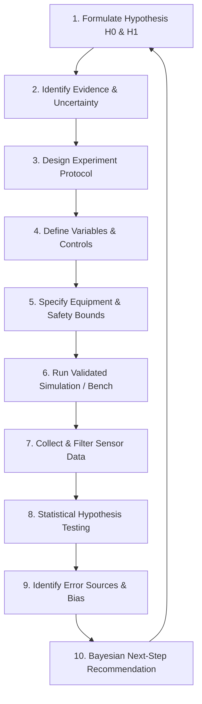

# STARK AI — AI Model & Scientific Experiment Lifecycle Guide

**Document Version:** 4.0.0  
**Project:** STARK AI / JARVIS (`D:\Jarvis`)  
**Scope:** AI Model Development, Dataset Curation, Benchmark Evaluation, Quantization Analysis, and Closed-Loop Scientific Experimentation  

---

## 1. Overview

STARK AI includes an enterprise-grade AI model lifecycle management suite and a closed-loop scientific experimentation engine. Rather than relying solely on cloud model prompting, STARK AI can discover local model weights, validate and curate datasets, configure LoRA/QLoRA adapters, run quantitative benchmarks, analyze quantization tradeoffs, and conduct hypothesis-driven scientific experiments.

---

## 2. AI Model Lifecycle Architecture (`server/modelLifecycleManager.js`)

### 2.1 Local Model Discovery

STARK AI checks local host runtimes and caches:

- **Ollama:** `%USERPROFILE%\.ollama\models\manifests`
- **Hugging Face Hub:** `%USERPROFILE%\.cache\huggingface\hub`
- **LM Studio:** `%USERPROFILE%\.cache\lm-studio\models`

```javascript
const { modelLifecycleManagerInstance } = require('./server/modelLifecycleManager.js');

const discovery = modelLifecycleManagerInstance.discoverLocalModels();
console.log(discovery.searchedSources);
// Returns accessible paths, discovered model counts, and registered local models
```

### 2.2 Dataset Curation, Deduplication & Versioning

Datasets must satisfy strict structural schemas and undergo cryptographic deduplication:

- **Exact Deduplication:** Normalizes text and hashes instruction-response pairs via SHA-256.
- **Train/Validation Split:** Configurable split (default 80/20).
- **Lineage Hash:** Generates a 64-character SHA-256 checksum over clean records.

```javascript
const prep = modelLifecycleManagerInstance.prepareDataset({
  name: 'aerospace_structures_qa',
  records: [
    { instruction: 'Calculate tip deflection', response: 'delta = F * L^3 / (3 * E * I)' },
    { instruction: 'Calculate tip deflection', response: 'delta = F * L^3 / (3 * E * I)' }, // Auto-deduplicated
    { instruction: 'Define yield strength', response: 'Stress at 0.2% plastic strain offset' }
  ],
  valSplit: 0.2
});
// prep.metadata.cleanRecordsCount: 2
// prep.metadata.duplicatesRemoved: 1
```

### 2.3 LoRA / QLoRA Hyperparameter Configuration

Before attempting model fine-tuning, STARK AI audits host VRAM and RAM:

- Computes frozen model weight memory ($M_{weights} = N \times B_{param}$).
- Computes trainable adapter memory and activation buffer memory.
- Verifies whether host RAM is sufficient ($RAM_{avail} \ge VRAM_{req} + 4\text{ GB}$).
- Generates a reproducible PyTorch/PEFT Python script.

```javascript
const ftConfig = modelLifecycleManagerInstance.configureFineTuning({
  baseModelId: 'model_gemma_2_2b_local',
  datasetId: 'ds_aerospace_structures_qa',
  hyperparameters: {
    loraRank: 16,
    loraAlpha: 32,
    learningRate: 2e-4,
    epochs: 3
  }
});

console.log(ftConfig.estimatedResourceNeeds);
// { totalVramRequiredGb: 2.8, feasibleOnCurrentHost: true }
```

### 2.4 Benchmark Evaluation & Regression Detection

Evaluates model accuracy against standardized domain questions:

- Computes exact match score and accuracy percentage.
- Measures token generation latency (ms/token).
- Flags `REGRESSION_DETECTED` if accuracy drops below 75%.

### 2.5 Quantization Analysis

Compares memory, latency, and accuracy deltas across:

- **FP16:** 2.0 bytes/parameter (baseline accuracy)
- **Q8_0:** 1.0 byte/parameter (~50% VRAM reduction, -0.2% accuracy delta)
- **Q4_K_M:** 0.55 bytes/parameter (~72% VRAM reduction, -1.2% accuracy delta, 1.6x speedup)
- **IQ3_M:** 0.42 bytes/parameter (~79% VRAM reduction, -3.5% accuracy delta)

---

## 3. Closed-Loop Scientific Experimentation (`server/closedLoopExperimentationEngine.js`)

STARK AI implements a 10-step closed-loop scientific method connecting theory, simulation, and permitted physical measurements:



### 3.1 Designing an Experiment

```javascript
const { closedLoopExperimentationEngineInstance } = require('./server/closedLoopExperimentationEngine.js');

const exp = closedLoopExperimentationEngineInstance.designExperiment({
  title: 'Cantilever Beam Elastic Deflection Test',
  domain: 'PHYSICS_STRUCTURAL',
  hypothesis: {
    statement: 'Cantilever deflection obeys linear cubic Euler-Bernoulli equation within p > 0.05.',
    nullHypothesisH0: 'Observations do not deviate from Euler-Bernoulli predictions.',
    alternativeHypothesisH1: 'Significant deviation observed.'
  },
  independentVariables: [{ name: 'tipLoadN', range: [100, 1000], unit: 'N' }],
  dependentVariables: [{ name: 'deflectionMm', unit: 'mm' }],
  safetyConstraints: [
    'Max stress < 450 MPa',
    'Emergency stop active'
  ]
});
```

### 3.2 Executing Run & Statistical Analysis

```javascript
// Step 6 & 7: Execute run
closedLoopExperimentationEngineInstance.executeRun(exp.id, 'SIMULATED', 20);

// Step 8 & 9: Statistical Analysis
const analysis = closedLoopExperimentationEngineInstance.analyzeResults(exp.id);
console.log(analysis.statisticalAnalysis);
// {
//   sampleSize: 20,
//   degreesOfFreedom: 19,
//   meanResidualMm: 0.00012,
//   tStatistic: 0.284,
//   pValue: 0.779,
//   cohensD: 0.063,
//   conclusion: 'CONFIRMED: Observations match theoretical physics predictions (p >= 0.05)'
// }
```

### 3.3 Physical Test Bench Safety Enforcement

Any request to execute a physical bench test (`PHYSICAL_BENCH`) without connected hardware or verified operator tokens returns:

- Status: `PHYSICAL_BENCH_UNAVAILABLE`
- Grounding: `SIMULATION_ALTERNATIVE_AVAILABLE`
- Precludes unauthorized hazardous physical actuation.
