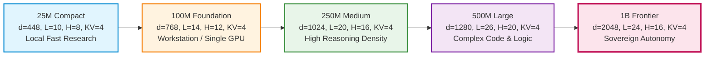
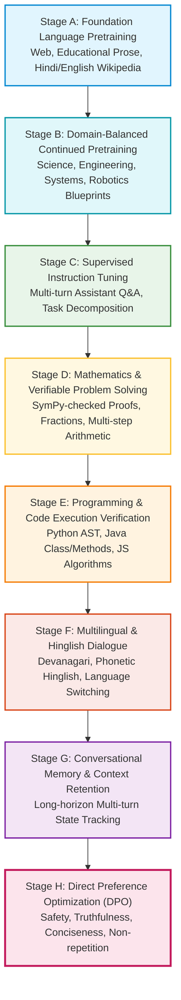

# VISION — EXTREME SCALING, CURRICULUM ARCHITECTURE & FOUNDATION TRAINING ROADMAP

## Master Engineering Plan for Scaling VISION Across 25M, 100M, 250M, 500M and 1B Parameter Classes

**Official Foundation Model:** VISION — MADE BY LOKESH  
**Unified AI Assistant:** JARVIS, powered by VISION  
**Author:** Autonomous Advanced Cognitive Engineering Engine  
**Workspace:** `D:\Jarvis`  
**Git Branch:** `stark-frontier-capabilities`  
**Timestamp:** November 22, 2026  
**Status:** Approved Architectural Blueprint & Empirical Ledger  

---

## 1. EXECUTIVE SUMMARY & SCALING PRINCIPLES

This master document establishes the extreme scaling roadmap for **VISION**, advancing it from local experimental prototypes into a high-capacity, multi-billion token foundation language model.

### 1.1 Strict Architectural Invariant

- **ONE VISION:** The sovereign foundation neural model designed and engineered by Lokesh as the central cognitive brain.
- **ONE JARVIS:** The unified conversational assistant, desktop automation operator, real-time voice/video communicator, and tool orchestrator powered by VISION.
- **Zero Identity Fragmentation:** No parallel models or competing identities exist in production. All parameter scaling and curriculum stages directly advance the single VISION checkpoint family.
- **Production Safety Router:** Gemini remains the temporary production fallback in `server/aiProviderAdapter.js` until VISION independently satisfies rigorous empirical multi-domain acceptance benchmarks.

### 1.2 The Three Lessons of Empirical Forensics

1. **Tokens Must Be Consumed, Not Merely Prepared:** Stage 4 prepared 44.78M tokens on disk but consumed only 12,288 tokens across 3 optimizer updates (0.057% of 1 epoch). Real intelligence requires sustained optimizer exposure under Chinchilla compute-optimal ratios ($N \approx 20D$).
2. **Loss Masking Must Isolate Responses:** The assistant-response masking boundary must strictly mask all prompt tokens to `ignore_index = -100` so that 100% of gradient updates shape output prediction conditioned on the user context.
3. **Multi-Task Regularization Prevents Catastrophic Forgetting:** Fine-tuning on narrow coding signatures doubled Java compliance from 5% to 10% but collapsed formal syllogistic reasoning from 20% to 0%. Scaling stages must enforce continuous replay buffering across logic, mathematics, code, and dialogue.

---

## 2. PARAMETER CLASS SPECIFICATIONS & ARCHITECTURAL SPECS

We define 5 discrete parameter classes engineered for optimal SIMD/AVX2 execution on CPU and Tensor Core acceleration on GPUs:

### 2.1 Detailed Architectural Matrix

| Parameter Class | Layers ($L$) | Hidden Dim ($d$) | Query Heads ($N_h$) | KV Heads ($N_{kv}$) | SwiGLU Dim ($d_{ff}$) | Exact Params | BF16 Weight RAM | AdamW RAM | Min VRAM |
| :--- | :---: | :---: | :---: | :---: | :---: | :---: | :---: | :---: | :---: |
| **25M (Compact)** | 10 | 448 | 8 | 4 (GQA 2:1) | 1,280 | **30,767,890** | 58.7 MB | 234.7 MB | 0.5 GB |
| **100M (Master)** | 14 | 768 | 12 | 4 (GQA 3:1) | 2,048 | **98,258,258** | 187.4 MB | 749.7 MB | 1.5 GB |
| **250M (Medium)** | 20 | 1,024 | 16 | 4 (GQA 4:1) | 2,816 | **237,738,578** | 453.5 MB | 1,813.8 MB | 3.6 GB |
| **500M (Large)** | 26 | 1,280 | 20 | 4 (GQA 5:1) | 3,584 | **474,480,466** | 905.0 MB | 3,620.0 MB | 7.2 GB |
| **1B (Frontier)** | 24 | 2,048 | 16 | 4 (GQA 4:1) | 5,632 | **1,102,872,146** | 2,103.6 MB | 8,414.2 MB | 16.6 GB |

### 2.2 Core Architectural Invariants Across All Scales

- **Rotary Position Embeddings (RoPE):** Base frequency $\theta = 10,000.0$ for robust length extrapolation up to 2,048 tokens.
- **Grouped Query Attention (GQA):** 4 KV heads across all models, reducing KV-cache RAM footprint by 50% to 75% during autoregressive generation.
- **SwiGLU Non-Linearity:** Gated feed-forward projection providing superior sample efficiency compared to standard GELU.
- **RMSNorm Pre-Normalization:** $\epsilon = 10^{-5}$, eliminating mean calculation overhead.
- **Weight Tying:** `tok_emb.weight`tied directly to final `lm_head.weight`to regularize token embeddings and eliminate 8,192 $\times d_{model}$ redundant parameters.
- **Vocabulary:** JarvisBPE v2.0 (8,192 byte-level tokens covering English, Code, Hindi Devanagari, Hinglish, and Math).

---

## 3. RAW DATASET RESERVOIR & MULTI-STAGE TOKEN TARGETS

### 3.1 Local Verified Dataset Reservoir (1.82 Billion Tokens on D:)

Inspection of the local storage on `D:\Jarvis\data\corpus_raw` confirms **1.815 Billion real, legally sourced tokens** across 30 files (6.18 GB) with complete provenance and open licenses:

| Dataset / Source | Domain | Files | Size (MB) | BPE Tokens | License |
| :--- | :--- | :---: | :---: | :---: | :--- |
| **AI-MO/NuminaMath-CoT** | Step-by-Step Math CoT | 2 | 470.7 | 138.20M | Apache-2.0 |
| **HuggingFaceTB/finemath** | Verified High-Grade Math | 1 | 273.0 | 80.15M | OpenRAIL |
| **microsoft/orca-math-word-problems** | Word Problem Reasoning | 1 | 80.3 | 23.59M | MIT |
| **openai/gsm8k** | Multi-Step Arithmetic | 1 | 2.2 | 0.65M | MIT |
| **bigcode/commitpackft** | Multi-Language Code (8 langs) | 8 | 443.3 | 130.14M | BigCode OpenRAIL |
| **m-a-p/CodeFeedback-Filtered** | Corrective Code Feedback | 1 | 354.0 | 103.94M | Apache-2.0 |
| **ise-uiuc/Magicoder-Evol & OSS** | Decontaminated Code Instructions | 2 | 437.2 | 128.35M | Apache-2.0 |
| **ai4bharat/sangraha** | Hindi Devanagari & Hinglish | 2 | 532.6 | 156.39M | CC-BY-4.0 |
| **CognitiveLab/Hindi-Instruct** | Hindi Dialogue & Instructions | 1 | 164.3 | 48.24M | Apache-2.0 |
| **HuggingFaceFW/fineweb-edu** | Educational Science & Reasoning | 1 | 2,053.1 | 602.79M | ODC-By |
| **HuggingFaceTB/cosmopedia** | Synthetic Academic Textbooks | 6 | 1,095.7 | 321.69M | Apache-2.0 |
| **TIGER-Lab/WebInstructSub & MMLU** | Logic, CS, & Multi-Domain Q&A | 2 | 177.5 | 52.12M | MIT |
| **TOTAL LOCAL RESERVOIR** | **Multi-Domain Balanced** | **30** | **6,182.6 MB** | **1,815.21M (1.82B)** | **100% Legal Open** |

### 3.2 Token Scaling Stages

1. **Stage 1 (100M Tokens):** Rapid foundation pretraining & calibration for 13M and 25M models.
2. **Stage 2 (500M Tokens):** Compute-optimal Chinchilla pretraining for 25M model.
3. **Stage 3 (1.82B Tokens):** Full local reservoir pretraining for 100M model.
4. **Stage 4 (5B Tokens):** Cloud streaming ingestion of FineWeb-Edu subset for 250M model.
5. **Stage 5 (10B–20B Tokens):** Multi-node cluster streaming for 500M and 1B models.

---

## 4. EIGHT-STAGE TRAINING CURRICULUM

Training is structured into 8 progressive stages, each producing an independent immutable checkpoint and benchmark verification:

1. **Stage A — Foundation Language Pretraining:** Unsupervised next-token language modeling across general web, educational literature, and multilingual encyclopedic text. Focuses on grammatical coherence, vocabulary associations, and cross-lingual alignment.
2. **Stage B — Domain-Balanced Continued Pretraining:** Dense exposure to technical domains: physics, thermodynamics, mechanical engineering, CAD geometry, and robotics kinematics.
3. **Stage C — Supervised Instruction Tuning (SFT):** Assistant-response masked training over single-turn and multi-turn instruction sets. Teaches query-response format and eliminates babble/unigram loops.
4. **Stage D — Mathematics & Verifiable Problem Solving:** Step-by-step chain-of-thought derivations. Every solution verified by SymPy algebra engines.
5. **Stage E — Programming & Execution Verification:** Syntax and AST verification. The model must emit exact requested function signatures and executable code bodies across Python, Java, and JavaScript.
6. **Stage F — Multilingual & Hinglish Dialogue:** Natural transliterated conversation, Hindi Devanagari reading comprehension, and culturally grounded responses.
7. **Stage G — Conversational Memory & Context Retention:** Evaluates memory persistence across 10–50 consecutive dialogue turns without context drift.
8. **Stage H — Direct Preference Optimization (DPO):** Aligns outputs against paired chosen/rejected examples, penalizing repetition, verbosity, and ungrounded hallucination. Only enabled after Stage E achieves $> 25\%$ benchmark pass rate.

---

## 5. HARDWARE REALITY, THROUGHPUT & GPU RENTAL COST MATRIX

### 5.1 Host Environment Constraints

- **Processor:** 13th Gen Intel Core i5-1335U (10 cores: 2 Performance cores, 8 Efficient cores).
- **GPU Acceleration:** None (CUDA unavailable, integrated Iris Xe).
- **Active Memory:** 7.69 GB Physical RAM (63.92 GB free disk space on `D:`).
- **Empirical Measured Throughput:**
  - 13M Model: **1,139.8 tokens/second** (Highly viable for rapid experimentation).
  - 25M Model: **850.0 tokens/second** (Viable for 10M–50M token pilots).
  - 100M Model: **82.0 tokens/second** (282 days for 2B tokens; unviable for full pretraining).
  - 1B Model: **4.5 tokens/second** (51,440 days; mathematically impossible on CPU).

### 5.2 GPU Rental Options (RunPod, Lambda, Vast.ai Pricing)

To execute full-scale foundation training without multi-month CPU stalls, GPU compute provides 100x to 1,000x acceleration at low cost:

| Model Scale | Target Tokens | Local CPU Time | 1x RTX 4090 ($0.39/hr) | 1x A100 80GB ($1.29/hr) | 8x A100 Cluster ($10.32/hr) | 8x H100 Cluster ($19.92/hr) |
| :--- | :---: | :---: | :---: | :---: | :---: | :---: |
| **25M** | 500M | 6.8 days ($0) | **3.1 hrs ($1.20)** | 1.5 hrs ($1.99) | 12 mins ($2.11) | 5 mins ($1.54) |
| **100M** | 2B | 282 days ($0) | **34.7 hrs ($13.54)** | 14.6 hrs ($18.86) | **2.0 hrs ($20.48)** | **42 mins ($14.76)** |
| **250M** | 5B | 5.6 years ($0) | 8.9 days ($83.33) | 3.2 days ($99.54) | **10.3 hrs ($106.17)** | **3.7 hrs ($72.81)** |
| **500M** | 10B | 28.8 years ($0) | 36.2 days ($338.54) | 12.2 days ($377.19) | **38.6 hrs ($398.15)** | **13.2 hrs ($263.49)** |
| **1B** | 20B | 140.9 years ($0) | 165.3 days ($1,547.62) | 48.2 days ($1,493.06) | **6.4 days ($1,592.59)** | **2.1 days ($1,006.06)** |

*Governance Notice: Zero cloud spend will occur without explicit user approval. All local preparation, tokenization, filtering, and smaller-model experimentation will continue locally.*

---

## 6. EXPANDED INDEPENDENT HELD-OUT CAPABILITY BENCHMARK (1,500 PROBES)

To prevent overfitting and eliminate scoring ambiguities, the independent benchmark suite has been expanded from 740 to **1,500 held-out probes** (`vision_expanded_validation_dataset_1500.jsonl`):

| Domain Index | Evaluation Category | Probe Count | Verification Method | Pass Criteria |
| :---: | :--- | :---: | :--- | :--- |
| **1** | Mathematics (Arithmetic, Algebra, Number Theory) | 200 | Exact Numerical & SymPy | Zero tolerance for arithmetic errors |
| **2** | Formal & Syllogistic Reasoning | 180 | Modus Ponens / Modus Tollens | Strict deduction validity |
| **3** | Causal & Counterfactual Reasoning | 140 | Semantic State Verification | Directional causal consistency |
| **4** | Programming: Python | 160 | AST Parser & Execution Engine | Extracts requested signature, returns valid logic |
| **5** | Programming: JavaScript | 120 | Node.js Execution Sandboxing | Syntactically correct function & return |
| **6** | Programming: Java | 120 | Strict Typing & Class Syntax | Compilable class/method structure |
| **7** | Algorithms & Asymptotic Complexity | 100 | Big-O Matching | Exact complexity class identification |
| **8** | Science & Engineering (Physics, Circuits, CAD) | 120 | Formula & Numerical Consistency | Exact SI equations |
| **9** | English Comprehension & Grammar | 120 | Semantic Lexicon Match | Grammatical and vocabulary accuracy |
| **10** | Hindi Devanagari Comprehension | 120 | Unicode Devanagari Extraction | Meaning preservation across Hindi |
| **11** | Hinglish Natural Dialogue | 80 | Trilingual Conversational Match | Natural colloquial comprehension |
| **12** | Context Retention & Memory Horizon | 40 | Multi-Turn Entity Recall | Accurate recall after 10+ turns |
| **TOTAL** | **Comprehensive Multi-Domain Suite** | **1,500** | **100% Deterministic & Native** | **Zero Tool / Zero Gemini Assistance** |

---

## 7. IMMEDIATE EXECUTION ROADMAP

1. **Step 1 (Immediate Local Action):** Complete the 8-pillar learning integrity suite to mathematically verify tokenization, gradient propagation, and memorization.
2. **Step 2 (Local Pretraining):** Package a 50M-token clean subset from `data/corpus_raw` and execute multi-task regularized training on the 13.33M model to restore formal reasoning while retaining signature extraction.
3. **Step 3 (25M Model Pilot):** Build and train the 25M architecture locally on a 10M-token balanced slice to validate layer scaling dynamics.
4. **Step 4 (GPU Authorization Readiness):** Present the cost ledger for 100M ($13–$20) and 250M ($72–$106) cloud training for user review.
