# VISION — Foundation Architecture Proposal & Exact Parameter Scaling

## Executive Summary

Based on the forensic audit of the 13.33M micro-model failure and parameter capacity limits, this proposal specifies the **Modern Pure-Text Decoder Transformer Specifications** across six exact parameter tiers (30M, 50M, 100M, 250M, 500M, 1B).

```text
+-------------------------------------------------------------------------------------------------------------+
|                                  FOUNDATION ARCHITECTURAL SCALING SPECIFICATIONS                            |
+-------+--------------------+--------+----------+---------+--------+----------+-----------------+------------+
| Tier  | Model Target       | d_model| n_layers | n_heads | d_ff   | Vocab    | Non-Emb Params  | Total Tied |
+-------+--------------------+--------+----------+---------+--------+----------+-----------------+------------+
| Tier 1| 30M Micro-Model    | 512    | 8        | 8 / 2   | 1,376  | 16,384   | 22.16M (72.5%)  | 30.55M     |
| Tier 2| 50M Compact Model  | 640    | 10       | 10 / 2  | 1,728  | 16,384   | 43.15M (80.4%)  | 53.64M     |
| Tier 3| 100M Core Model    | 768    | 14       | 12 / 4  | 2,048  | 16,384   | 86.73M (87.3%)  | 99.31M     |
| Tier 4| 250M Scale Model   | 1,024  | 20       | 16 / 4  | 2,816  | 32,000   | 224.83M (87.3%) | 257.60M    |
| Tier 5| 500M Scale Model   | 1,280  | 26       | 20 / 4  | 3,584  | 32,000   | 460.26M (91.8%) | 501.22M    |
| Tier 6| 1B Frontier Model  | 2,048  | 24       | 16 / 4  | 5,632  | 32,000   | 1,069.74M(94.2%)| 1,135.28M  |
+-------+--------------------+--------+----------+---------+--------+----------+-----------------+------------+
```

---

## 1. Architectural Design Invariants

To avoid the historical errors identified during the audit, all tiers conform to these architectural standards:

1. **Standardized Head Dimension**: $d_k = 64$ across all tiers (except Tier 6 at 128). This standardizes RoPE frequencies and prevents the $d_k = 40$ attention dot-product bottleneck found in the 13M model.
2. **Grouped Query Attention (GQA)**: A 4:1 query-to-KV head ratio reduces KV cache memory consumption by 75% during inference while preserving full attention expressive power.
3. **SwiGLU FFN Dimension**: Intermediate dimension set to $d_{\text{ff}} = \text{int}(2.67 \times d_{\text{model}})$ (standardized in LLaMA-3 / Mistral), providing optimal associative memory capacity per parameter.
4. **Pre-Layer RMSNorm with QK-Norm**: RMSNorm is applied before attention and MLP blocks, supplemented with QK-Norm to eliminate internal logit drift and stabilize half-precision training.
5. **Decoupled Text Foundation**: In contrast to previous versions where vision and audio encoders were tightly bound to the language transformer from step 0, **the text foundation model is trained as a pure language transformer**. Multimodal capabilities are added via post-pretraining projection adapters.

---

## 2. Component Parameter Breakdown (100M Core Foundation)

For the **VISION 100M Core Foundation Model** ($99,309,312$ total tied parameters):

```text
+-------------------------------------------------------------------------------------------------------------+
|                                99.31M CORE FOUNDATION PARAMETER BREAKDOWN                                   |
+------------------------------------+--------------------------+-----------------------+---------------------+
| Component                          | Mathematical Dimension   | Exact Parameter Count | Percent of Model    |
+------------------------------------+--------------------------+-----------------------+---------------------+
| Token Embeddings (tok_emb)         | 16,384 x 768             | 12,582,912            | 12.67%              |
| Attention Query Projections        | 14 x (768 x 768)         | 8,257,536             | 8.32%               |
| Attention Key Projections (GQA)    | 14 x (768 x 256)         | 2,752,512             | 2.77%               |
| Attention Value Projections (GQA)  | 14 x (768 x 256)         | 2,752,512             | 2.77%               |
| Attention Output Projections       | 14 x (768 x 768)         | 8,257,536             | 8.32%               |
| Attention QK-Norms                 | 14 x (64 + 64)           | 1,792                 | 0.00%               |
| Layer RMSNorms (norm1 + norm2)     | 14 x (768 + 768)         | 21,504                | 0.02%               |
| SwiGLU Gate Projections            | 14 x (768 x 2,048)       | 22,020,096            | 22.17%              |
| SwiGLU Up Projections              | 14 x (768 x 2,048)       | 22,020,096            | 22.17%              |
| SwiGLU Down Projections            | 14 x (2,048 x 768)       | 22,020,096            | 22.17%              |
| Final RMSNorm (norm_f)             | 768                      | 768                   | 0.00%               |
| LM Head (tied to tok_emb)          | Re-uses tok_emb storage  | 0 (Tied)              | 0.00%               |
+------------------------------------+--------------------------+-----------------------+---------------------+
| TOTAL NON-EMBEDDING TRANSFORMER    | 14 Layers @ 6.19M/layer  | 86,726,400 parameters | 87.33%              |
| TOTAL MODEL PARAMETERS (TIED)      | -                        | 99,309,312 parameters | 100.00%             |
+------------------------------------+--------------------------+-----------------------+---------------------+
```

---

## 3. Comparison with the 13.33M Architecture

```mermaid
flowchart LR
    subgraph Micro13M["13.33M Micro Architecture"]
        M_emb["Embedding: 2.62M (21.9%)"]
        M_tx["Transformer Weights: 9.34M (78.1%)"]
        M_hd["Head Dim: 40 | GQA: 8/4 | Layers: 8"]
        M_mm["Embedded Vision/Audio: 1.37M"]
    end

    subgraph Core100M["99.31M Core Foundation Architecture"]
        C_emb["Embedding: 12.58M (12.7%)"]
        C_tx["Transformer Weights: 86.73M (87.3%)"]
        C_hd["Head Dim: 64 | GQA: 12/4 | Layers: 14"]
        C_mm["Pure Text Decoupled Foundation"]
    end

    Micro13M -->|"9.3x Non-Embedding Parameter Capacity Expansion"| Core100M
```



### Why 99.31M Resolves the Algorithmic Bottleneck

1. **9.3x Parameter Capacity in Dynamic Layers**: Moving from 9.34M to 86.73M transformer weights expands associative memory capacity ninefold, providing the parameters necessary to host multi-step carry routing and programming AST transitions without interference.
2. **Layer Depth Increase (8 to 14 Layers)**: Enables hierarchical composition: early layers form token n-grams, middle layers form grammatical syntactic trees, and late layers execute variable binding and reasoning operations.
3. **Head Dimension Modernization ($40 \to 64$)**: Provides standard dot-product attention precision, eliminating numerical underflow during long-range attention softmax calculations.
