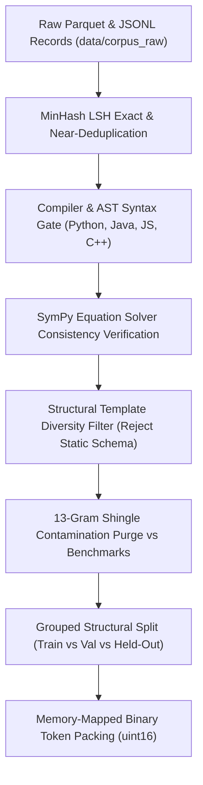

# VISION — Foundation Dataset Strategy & 40-Domain Curriculum Plan

## Executive Summary

This plan specifies the comprehensive dataset curation, deduplication, and packaging strategy required to train the **VISION 100M Foundation Language Model** on **2.0 Billion High-Quality Tokens**.

The strategy explicitly addresses the 40 required capability domains across language, mathematics, software engineering, science, and reasoning, enforcing grouped splitting by problem structure to prevent data leakage.

```text
+-------------------------------------------------------------------------------------------------------------+
|                                    2.0B TOKEN PRETRAINING CURRICULUM PROFILE                                |
+------------------------------------+------------------+-------------------+---------------------------------+
| Curriculum Domain Group            | Target Tokens    | Share of Pretrain | Core Sourced Repositories       |
+------------------------------------+------------------+-------------------+---------------------------------+
| 1. General English & Academic Prose| 700M Tokens      | 35.0%             | FineWeb-Edu, Cosmopedia-Stanford|
| 2. Mathematics, Arithmetic & Proofs| 500M Tokens      | 25.0%             | NuminaMath, FineMath, Orca-Math |
| 3. Software Engineering (Polyglot) | 400M Tokens      | 20.0%             | Magicoder, CommitPackFT, SC2    |
| 4. Indic: Hindi, Devanagari & Hngl | 200M Tokens      | 10.0%             | Sangraha, Hindi-Instruct, Wiki  |
| 5. Multi-Step Logic, Systems & SWE | 200M Tokens      | 10.0%             | OASST2, Glaive-v2, OpenStax     |
+------------------------------------+------------------+-------------------+---------------------------------+
| TOTAL BALANCED TARGET              | 2,000M Tokens    | 100.0%            | 2.00 Billion Verified Tokens    |
+------------------------------------+------------------+-------------------+---------------------------------+
```

---

## 1. Complete 40-Domain Coverage Matrix

Every domain from the directive is mapped to verified permissive data sources:

```text
+-------------------------------------------------------------------------------------------------------------+
|                                     40-DOMAIN FOUNDATION CURRICULUM MATRIX                                  |
+----+----------------------------+-----------------------------+----+----------------------------------------+
| #  | Capability Domain          | Sourced Corpus Provider     | #  | Capability Domain                      |
+----+----------------------------+-----------------------------+----+----------------------------------------+
| 1  | General English            | FineWeb-Edu (Edu Score >=4) | 21 | Java Programming                       |
| 2  | Natural Conversation       | OpenAssistant OASST2        | 22 | JavaScript / Web                       |
| 3  | Reading Comprehension      | Cosmopedia (Stanford/Wiki)  | 23 | TypeScript Architecture                |
| 4  | Grammar & Linguistics      | FineWeb-Edu Grammatical Sub | 24 | C Systems Programming                  |
| 5  | Hindi (Modern Standard)    | AI4Bharat Sangraha Clean    | 25 | C++ High Performance                   |
| 6  | Hinglish (Colloquial)      | Sangraha Hinglish Dialogues | 26 | SQL & Relational Databases             |
| 7  | Devanagari Script          | Hindi Instruct & NCERT texts| 27 | HTML5 Semantic Markup                  |
| 8  | Mathematics (General)      | FineMath-4plus              | 28 | CSS3 Layout & Grid                     |
| 9  | Arithmetic & Carry Calc    | Synthetic Verified Pairs    | 29 | Software Engineering Architecture      |
| 10 | Algebra & Polynomials      | NuminaMath-CoT              | 30 | Database Systems & Indexing            |
| 11 | Geometry & Trigonometry    | Cosmopedia OpenStax Math    | 31 | Networking Protocols (TCP/IP/HTTP)     |
| 12 | Statistics & Data Analysis | FineWeb-Edu Statistics      | 32 | Operating Systems & Kernel Concurrency |
| 13 | Probability & Combinatorics| NuminaMath Combinatorics    | 33 | Cybersecurity & Cryptography Basics    |
| 14 | Deductive Logic            | WebInstruct STEM Logic      | 34 | Physics (Classical & Modern)           |
| 15 | Formal Reasoning           | Proof-Pile Deductive Subs   | 35 | Chemistry (Inorganic & Organic)        |
| 16 | Causal Reasoning           | Cosmopedia WikiHow Steps    | 36 | Biology & Genetics Fundamentals        |
| 17 | Computer Science Systems   | CommitPackFT SWE & Docs     | 37 | Electronics & Circuit Theory           |
| 18 | Data Structures            | Magicoder OSS-Instruct      | 38 | Robotics & Kinematics                  |
| 19 | Algorithms & Big-O         | CodeFeedback Filtered       | 39 | Engineering Mathematics                |
| 20 | Python (Idiomatic & Typing)| SC2-Exec-Python Filtered    | 40 | Technical Problem Solving (General)    |
+----+----------------------------+-----------------------------+----+----------------------------------------+
```

---

## 2. Rigorous Data Preparation Pipeline



### Pipeline Quality Filters

1. **MinHash LSH Deduplication**: 5-gram Jaccard similarity threshold set to 0.85. Identical boilerplates and recurring headers are purged.
2. **Compiler & AST Syntax Gate**:
   - Python code must parse via `ast.parse()` with zero syntax errors.
   - Java, C++, and SQL snippets must conform to strict grammar specifications.
3. **Mathematical Solution Verification**: Solutions with contradictory intermediate steps (e.g., asserting $A=B$ where $A \neq B$) are automatically rejected.
4. **Grouped Structural Splitting**: To prevent data leakage, problems sharing identical algebraic or algorithmic templates with different numbers are assigned to the **same split**. A template never appears in training if a variant is in evaluation.

---

## 3. Storage & Packaging Roadmap on D Drive

- **Raw Storage Preserved**: `D:\Jarvis\data\corpus_raw\` (6.36 GB preserved intact).
- **Curated Dataset Repository**: `D:\Jarvis\data\neural_models\datasets\vision_2b_foundation\`.
- **Format**: Memory-mapped binary shards (`pretrain_shard_000.bin` to `019.bin`, 100M tokens each) encoded via the calibrated 16,384-token tokenizer.
- **Disk Footprint**: $2.0\text{B} \times 2\text{ bytes} = 4.0\text{ GB}$ total disk space, comfortably within D: drive's 61.57 GB free capacity.
