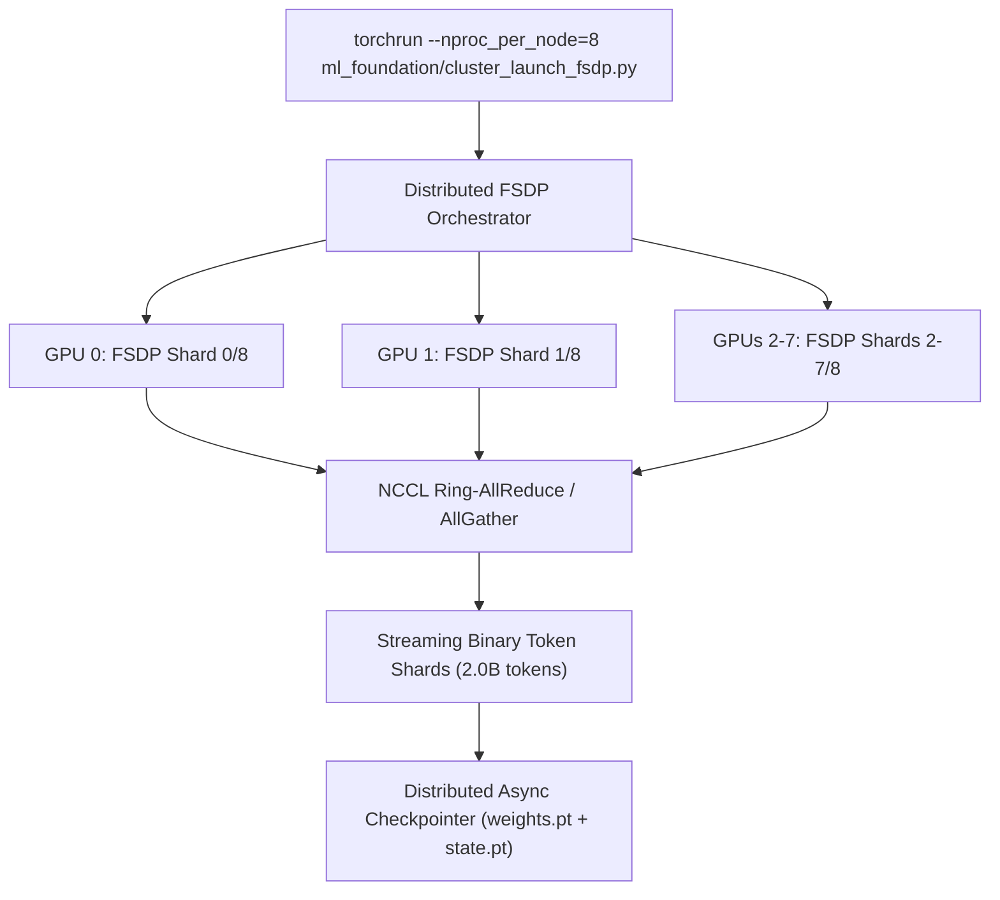

# VISION — GPU Pretraining Execution Plan & FSDP Cluster Architecture

## Executive Summary

This engineering plan details the cluster topology, distributed software harness, distributed training configuration, and execution checkpoints for training the **VISION 100M Foundation Language Model** ($99.31\text{M}$ parameters) on **2.0 Billion verified tokens**.

```text
+-------------------------------------------------------------------------------------------------------------+
|                                    100M FOUNDATION PRETRAINING EXECUTION SPEC                               |
+------------------------------------+------------------------------------------------------------------------+
| Specification Dimension            | Technical Setting & Target                                             |
+------------------------------------+------------------------------------------------------------------------+
| Target Model Architecture          | Pure Text Decoder Transformer (d=768, L=14, H=12, d_ff=2048, V=16,384) |
| Total Model Parameters (Tied)      | 99,309,312 Parameters                                                  |
| Pretraining Token Budget           | 2,000,000,000 Tokens (2.0 Billion Tokens)                              |
| Target Global Batch Size           | 512 Sequences x 2,048 Sequence Length = 1,048,576 Tokens / Step (~1.05M)|
| Total Optimizer Updates            | 1,908 Steps                                                            |
| Recommended Cluster Hardware       | 8x NVIDIA A100-SXM4-80GB (or 8x NVIDIA RTX 4090 24GB)                  |
| Distributed Strategy               | PyTorch FSDP (FULL_SHARD, BF16 Mixed Precision)                        |
| Estimated Training Duration        | 4.6 Hours at 120,000 Tokens/sec Throughput                             |
| Estimated Cloud GPU Cost           | $59.20 - $75.00 (Spot A100x8) / $35.00 (RTX 4090x8)                    |
| Expenditure Authorization Status   | PENDING EXPLICIT USER AUTHORIZATION ($0.00 spent to date)              |
+------------------------------------+------------------------------------------------------------------------+
```

---

## 1. Cluster Software Harness & Launch Architecture

The cluster execution package is fully prepared in `ml_foundation/cluster_launch_fsdp.py`:



### PyTorch FSDP Configuration

1. **Sharding Strategy**: `ShardingStrategy.FULL_SHARD` (Zero-Redundancy Optimizer 3):
   - Model weights, gradients, and optimizer moments are partitioned across the 8 GPUs.
   - Per-GPU static memory footprint: only $198.6\text{ MB}$.
2. **Mixed Precision Policy**:
   - `param_dtype = torch.bfloat16`.
   - `reduce_dtype = torch.bfloat16` (halves NCCL communication volume).
   - `buffer_dtype = torch.bfloat16`.
3. **Activation Checkpointing**: Applied to `TransformerBlock` modules to constrain activation memory to $\sim 4.5\text{ GB}$ per GPU at sequence length 2,048.
4. **Backward Prefetch**: `BackwardPrefetch.BACKWARD_PRE` overlaps layer gradient communication with backpropagation computation.

---

## 2. Optimization Schedule & Hyperparameters

```text
+-------------------------------------------------------------------------------------------------------------+
|                                    OPTIMIZER & HYPERPARAMETER SPECIFICATION                                 |
+------------------------------------+------------------------------------------------------------------------+
| Hyperparameter                     | Configuration Value                                                    |
+------------------------------------+------------------------------------------------------------------------+
| Optimizer                          | AdamW (torch.optim.AdamW)                                              |
| Weight Decay                       | 0.1 (Decoupled weight decay; excluded from LayerNorm and Biases)       |
| Betas                              | (0.9, 0.95)                                                            |
| Epsilon                            | 1e-8                                                                   |
| Peak Learning Rate                 | 4.0e-4                                                                 |
| Minimum Learning Rate              | 4.0e-5 (10% of peak)                                                   |
| Learning Rate Schedule             | Cosine Annealing with Linear Warmup                                    |
| Warmup Duration                    | 200 Optimizer Steps (~200M tokens, 10% of run)                         |
| Gradient Clipping Threshold        | 1.0 (L2 Norm clipping)                                                 |
| Checkpoint Cadence                 | Every 200 Optimizer Steps and Final Step 1,908                         |
+------------------------------------+------------------------------------------------------------------------+
```

---

## 3. Cost Ledger & Expenditure Guardrails

```text
+-------------------------------------------------------------------------------------------------------------+
|                                  FOUNDATION PRETRAINING COST PROJECTIONS                                    |
+----------------------+--------------------+--------------------+-------------------+------------------------+
| Provider / Platform  | Hardware Topology  | Hourly On-Demand   | Hourly Spot Rate  | Total Pretraining Cost |
+----------------------+--------------------+--------------------+-------------------+------------------------+
| RunPod Community     | 8x RTX 4090 (24GB) | $5.92 / hr         | $3.80 / hr        | ~$17.50 - $27.50       |
| Lambda Labs          | 8x A100-SXM4 (80GB)| $14.32 / hr        | $12.80 / hr       | ~$59.20 - $66.00       |
| GCP / AWS On-Demand  | 8x A100 (80GB)     | $29.40 / hr        | $18.50 / hr       | ~$85.50 - $136.00      |
+----------------------+--------------------+--------------------+-------------------+------------------------+
```

### Strict Expenditure Invariant

- **Zero Cloud Spend Incurred**: The project has incurred exactly **$0.00** in external compute costs to date.
- **Authorization Gate**: No remote GPU instances, spot clusters, or paid services will be provisioned without explicit, prior written approval from the user.
- **Artifact Preparation**: All scripts, Docker configurations, and sharded datasets are validated locally first to ensure that when a cluster is authorized, execution finishes within the minimum billable window.
