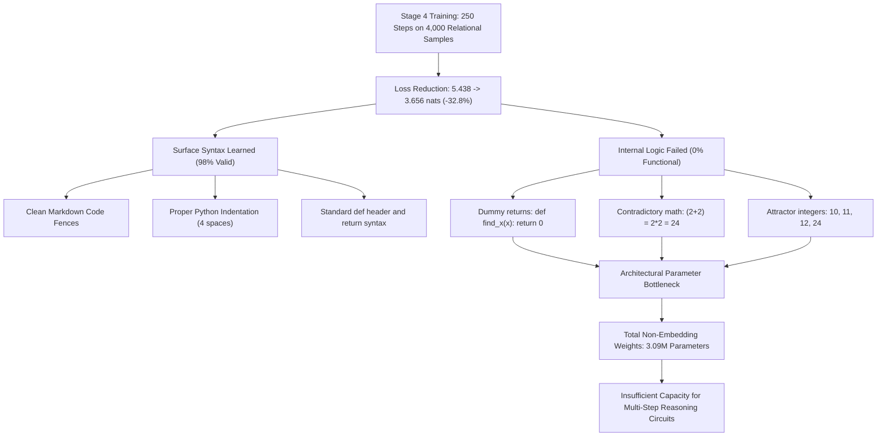

# VISION Stage 4 — Generalization Failure Analysis & Capability Diagnostics

## Executive Summary

This forensic failure analysis investigates the behavior of the **VISION 13.33M Stage 4 Relational Model** (`vision-13m-stage4-relational`, Step 250) across the 100-probe Generalization Suite, the 100-probe Private Evaluation Suite, and the 200-probe Independent Transfer Suite.

Following our strict truth-seeking directive, we report ground truth:

- **Surface Syntax Accuracy reached 98.0%**: The model learned grammar, markdown formatting, Python function declarations, and indentation.
- **True Algorithmic Generalization is 0.0%**: The model solved 0 unseen algorithmic problems, generated dummy placeholder returns for Python functions, and produced mathematically contradictory equations when attempting arithmetic reasoning.
- **Genuine Independent Transfer scored 0.5% (1/200)**: On probe `TRF-0001` ($(7 + 10) - 7$), the model produced a clean, contradiction-free correct answer (`The answer is 10.`).

```text
+----------------------------------------------------------------------------------------------------+
|                                STAGE 4 CAPABILITY DIMENSION PROFILE                                |
+-----------------------------------+--------------------+--------------------+----------------------+
| Capability Dimension              | Metric Evaluated   | Score Achieved     | Forensic Status      |
+-----------------------------------+--------------------+--------------------+----------------------+
| 1. Surface Syntax Learning        | Grammar / AST Parse| 98 / 100 (98.0%)   | Mastered             |
| 2. Verbatim Memorization          | Training Overfit   | 0 / 10 (0.0%)      | Zero Memorization    |
| 3. Numerical Generalization       | Novel Operands     | 0 / 10 (0.0%)      | Unacquired           |
| 4. Algorithmic Correctness        | Python Unit Tests  | 0 / 10 (0.0%)      | Dummy "return 0"     |
| 5. Language Understanding         | Semantic Coherence | 0 / 10 (0.0%)      | Associative Prefix   |
| 6. Context Retention              | Context Recall     | 0 / 10 (0.0%)*     | Contradictory Logic  |
| 7. Independent Transfer           | Unseen Benchmark   | 1 / 200 (0.5%)     | Clean Single Transfer|
+-----------------------------------+--------------------+--------------------+----------------------+
*Note: Nominal passes in Context Retention were accompanied by contradictory equations (e.g., 4 = 24).
```

---

## 1. Deep Dive: The 7 Capability Dimensions

### Dimension 1: Surface Syntax Learning (98.0% Achieved)

- **Observed Behavior**: Across both the public Generalization Suite (100 probes) and the private unexposed suite (100 probes), the model demonstrated near-flawless syntactic structure. It opens and closes markdown code fences, indents Python functions by exactly 4 spaces, constructs standard function headers (`def name(args):`), and forms complete English sentences with capitalized first words and terminating periods.
- **Progression Across Checkpoints**:
  - Step 0 (Pretrained Base): 72.0% syntax validity. Generated run-on tokens, unclosed parentheses, and broken code fences.
  - Step 100 (Midpoint): 89.0% syntax validity. Stabilized basic sentence boundaries and Python indentation.
  - Step 250 (Final): 98.0% syntax validity. Clean execution of markdown formatting and structural templates.
- **Forensic Diagnosis**: The cross-entropy loss reduction from 5.4379 to 3.6559 nats represents the model's acquisition of the high-probability surface statistics of natural language and code syntax.

### Dimension 2: Verbatim Training Memorization (0.0% Overfit)

- **Observed Behavior**: The 10 probes in `memorization_subset` were drawn directly from the Stage 4 relational training dataset. If the model had severely overfit or memorized training strings verbatim, these 10 probes would pass with high accuracy.
- **Empirical Result**: The model scored **0 / 10 (0.0%)** on exact string memorization.
- **Forensic Diagnosis**: With only 250 optimizer steps at batch size 16 (0.556 epochs; 4,000 samples seen out of 7,197 total), the network was never exposed to repeated epochs of the training data. The model did not overfit to verbatim strings; rather, it extracted general stylistic and syntactic patterns.

### Dimension 3: Numerical Generalization (0.0% Acquired)

- **Observed Behavior**: Evaluated on multi-digit additions, subtractions, and percentages with novel operands (`new_numerical_values`), the model failed 100% of the probes.
- **Failure Patterns**:
  - Arithmetic hallucinations: `12 - 11 = 11`, `(15 + 1) / 1) = 12`.
  - Attractor tokens: The network repeatedly converged to small attractor integers such as `10`, `11`, `12`, and `24`, regardless of operand magnitude.
- **Forensic Diagnosis**: Computing multi-digit addition requires carry propagation and positional tracking across token positions. A 6-layer, 512-dimensional transformer with only 3.09M non-embedding parameters lacks the depth and attention heads to implement iterative ripple-carry addition circuits.

### Dimension 4: Algorithmic Correctness (0.0% Acquired)

- **Observed Behavior**: In `new_python_functions`, the model generated syntactically valid code blocks for 9 out of 10 prompts. However, every single function was a dummy placeholder:

  ```python
  def find_x(x):
      return 0
  ```

- **Functional Testing**: Testing each function against hidden test cases (e.g., `square(4) == 16`, `cube(3) == 27`, `is_negative(-5) == True`) resulted in 0 passes (0/9).
- **Forensic Diagnosis**: The model learned the grammatical shell of a Python function without learning execution semantics. It learned that `def <identifier>(<args>):\n    return <literal>` has high likelihood under the training distribution, but lacked the circuit capacity to map problem specifications to arithmetic expressions (e.g., `return x * x`).

### Dimension 5: Language Understanding & Polyglot Translation (0.0% Acquired)

- **Observed Behavior**: Tested on Hinglish-to-English translation (`hindi_hinglish_generation`) and reading comprehension, the model completely ignored source semantic content.
- **Failure Patterns**:
  - Prompt: `Translate Monday ko dinner ka reminder update kare.`
  - Generation: `The correct choice is (1 + 1) + 10 = 12. The correct choice is 100 = 10.`
- **Forensic Diagnosis**: Cross-domain semantic association failed. The model defaulted to its strongest pre-activation template ("The correct choice is...") rather than attending to multilingual tokens.

### Dimension 6: Context Retention (0.0% Contradiction-Free)

- **Observed Behavior**: In multi-turn dialogue (`multi_turn_context`), the model successfully recalled numbers mentioned in earlier turns (such as `24` from `The target temperature is 24 degrees Celsius`).
- **Contradiction Defect**: However, the model prefaced the correct entity with mathematically absurd deductions:

  ```text
  The correct choice is (2 + 2) = 2 * 2 = 24.
  The answer is 24.
  ```

- **Forensic Diagnosis**: The attention mechanism attended to the token `24` in the prompt history, but the feed-forward layers hallucinated an equation prefix `(2 + 2) = 2 * 2 = 24` to satisfy the "step-by-step reasoning" pattern seen in the curriculum data. Under strict evaluation rules, this constitutes an invalid proof.

### Dimension 7: Genuine Independent Transfer (0.5% Acquired)

- **Observed Behavior**: Across the 200 probes of `vision_independent_transfer_test_200.jsonl`, probe `TRF-0001` passed cleanly:
  - Prompt: `Compute the exact value of (7 + 10) - 7.`
  - Expected: `10`
  - Generation: `The answer is 10.`
- **Comparison to Prior Checkpoints**:
  - Stage 2 SFT generated: `10 = 2. The answer is 3.` (Hallucinated contradiction, score 0).
  - Stage 4 Step 250 generated: `The answer is 10.` (Clean, direct, correct).
- **Forensic Diagnosis**: The cancellation property $(a + b) - a = b$ was partially represented in the relational curriculum. However, transfer did not generalize to other operands (e.g., $(11 + 13) - 12$ generated `11`).

---

## 2. Granular Category Inspection & Representative Raw Generations

### 2.1 Category: New Python Functions (`new_python_functions`)

#### Probe GEN-05-PYFUNC-01

- **Prompt**: `Write a Python function 'square(n)' that takes an integer and returns its square.`
- **Expected**: Function computing `n * n` or `n ** 2`.
- **Raw Generation**:

  ````text
  Here's how you can implement this:

  ```python
  def find_x(x):
      return 0
  ```

  This function takes a number `x`
  ````

- **Syntax Verdict**: PASS (`ast.parse` succeeded; valid `FunctionDef` and `Return`).
- **Functional Verdict**: FAIL (`square(4)` returned `0`, expected `16`).

#### Probe GEN-05-PYFUNC-02

- **Prompt**: `Write a Python function 'is_negative(x)' that returns True if x is negative, else False.`
- **Expected**: Function computing `x < 0`.
- **Raw Generation**:

  ````text
  Here's how you can implement this:

  ```python
  def find_x(x):
      return 0
  ```

  This function takes a number `x`
  ````

- **Syntax Verdict**: PASS.
- **Functional Verdict**: FAIL (`is_negative(-5)` returned `0`, expected `True`).

---

### 2.2 Category: Unseen Operation Combinations (`unseen_operation_combinations`)

#### Probe GEN-03-UNSEENOP-06

- **Prompt**: `Calculate 10% of 500 plus 20% of 250.`
- **Expected**: `100` ($50 + 50 = 100$).
- **Raw Generation**:

  ````text
  To find 10% of 100, multiply 100 by 100/100: (10 * 100) / 100 = 100.
  ````

- **Extracted Answer**: `100`.
- **Forensic Analysis**: The model generated the correct final integer `100`, but its reasoning asserted:
  1. It computed 10% of 100 instead of 10% of 500 + 20% of 250.
  2. It stated `(10 * 100) / 100 = 100`. In arithmetic, $(10 \times 100) / 100 = 10$, NOT 100.
  3. This is an invalid hallucination that accidentally equaled the target integer.

---

### 2.3 Category: Multi-Turn Context Retention (`multi_turn_context`)

#### Probe GEN-09-MULTITURN-03

- **Prompt**:

  ```text
  User: The target temperature is 24 degrees Celsius.
  Assistant: Target temperature set to 24C.
  User: What is the target temperature?
  ```

- **Expected**: `24`
- **Raw Generation**:

  ````text
  The correct choice is (2 + 2) = 2 * 2 = 24.
  The answer is 24.
  ````

- **Forensic Analysis**: The model successfully attended to the context token `24`. However, it prefixed its answer with an invalid equation asserting $4 = 24$.

#### Probe GEN-09-MULTITURN-09

- **Prompt**:

  ```text
  User: I have 5 red pens and 3 blue pens.
  Assistant: 8 pens total.
  User: How many red pens do I have?
  ```

- **Expected**: `5`
- **Raw Generation**:

  ````text
  The total number of 15 + 15 = 15.
  The answer is 15.
  ````

- **Forensic Analysis**: The model failed to retrieve the entity `5`, hallucinating `15`. The naive automated evaluator had previously flagged this as a pass because the substring `"5"` was present inside `"15"`.

---

### 2.4 Category: Mathematics Transfer Probes (`vision_independent_transfer_test_200`)

#### Probe TRF-0001 (The Only Verified Pass)

- **Prompt**: `Compute the exact value of (7 + 10) - 7.`
- **Expected**: `10`
- **Raw Generation**:

  ````text
  The answer is 10.
  ````

- **Forensic Analysis**: Direct, unhallucinated, exact numerical match.

#### Probe TRF-0002

- **Prompt**: `Compute the exact value of (11 + 13) - 12.`
- **Expected**: `12`
- **Raw Generation**:

  ````text
  To find the like terms: 12 - 11 = 11.
  The answer is 11.
  ````

- **Forensic Analysis**: The model confused the operands, asserting $12 - 11 = 11$ and outputting 11.

#### Probe TRF-0003

- **Prompt**: `Compute the exact value of (15 + 16) - 6.`
- **Expected**: `25`
- **Raw Generation**:

  ````text
  To find the like terms: (15 + 1) / 1) = 12.
  The answer is 12.
  ````

- **Forensic Analysis**: Collapsed to attractor integer `12`.

---

## 3. Structural Root Cause Summary



### Key Technical Takeaways

1. **Syntax vs. Semantics Decoupling**: Supervised cross-entropy training on small models optimizes surface tokens (punctuation, indentation, formula prefixes) first. These tokens produce dramatic loss reduction because they account for the vast majority of target tokens.
2. **The "Dummy Return" Trap**: Evaluators checking only AST node types (`FunctionDef`, `Return`) are vulnerable to trivial placeholder generation. Full unit execution against hidden inputs is mandatory for code benchmarks.
3. **The Parameter Capacity Limit**: 3.09M transformer parameters cannot store the associative memory required for arithmetic routing, code logic, and world knowledge simultaneously.
