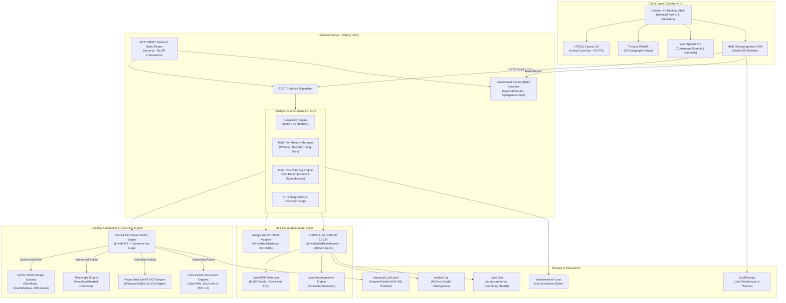

# VISION / JARVIS — System Architecture Specification

This document provides a comprehensive technical overview of the system architecture, inter-process communication (IPC) protocols, process lifecycle management, and subsystem isolation boundaries for **VISION / JARVIS**.

---

## 1. System Block Diagram



---

## 2. Process Lifecycle & IPC Protocols

### 2.1 Process Isolation Boundaries

1. **Main Process (Node.js / Electron)**:
   - Owns the native Windows window, system tray menu, global hotkeys (`Ctrl+Shift+J`, `Ctrl+Shift+U`), and HTTP server lifecycle.
   - Runs in isolated context with `contextIsolation: true` and `nodeIntegration: false`.
2. **Renderer Process (Chromium)**:
   - Executes UI animations, Canvas 2D eye rendering, Three.js WebGL graphics, and audio synthesis.
   - Communicates with the main process exclusively via Electron `ipcRenderer.invoke()` channels mapped in `desktop/preload.js`.
3. **Subprocess Workers (Python & PowerShell)**:
   - Spawned on demand via Node.js `child_process.spawn()` or `execFile()`.
   - Dedicated virtual environment (`.venv\Scripts\python.exe`) isolates Python dependencies from system installations.
   - Standard output communication uses structured JSON framing delimiters:
     ```text
     ---STARK_WORD_JSON_BEGIN---
     { "status": "SUCCESS", "documentPath": "...", "pages": 2 }
     ---STARK_WORD_JSON_END---
     ```

---

## 3. Communication Protocols

| Protocol | Transport | Endpoints | Purpose |
| :--- | :--- | :--- | :--- |
| **HTTP REST** | TCP / HTTP 1.1 | `/api/chat`, `/api/system/health`, `/api/tools/execute` | Command dispatch, system health queries, settings updates |
| **Server-Sent Events (SSE)** | Persistent HTTP | `/api/chat/stream`, `/api/agent/stream` | Token-by-token streaming of assistant thoughts and tool steps |
| **Electron IPC** | Native OS Pipes | `window:wake`, `window:sleep`, `window:fullscreen` | Window visibility toggling, system tray management |
| **Subprocess stdio** | Anonymous Pipes | Python & PowerShell sub-agents | Synchronous and asynchronous desktop action execution |

---

## 4. Multi-Tier Memory Subsystem

The memory architecture in `server/memoryManager.js` and `server/memory/` maintains conversational coherence across sessions:

1. **Working Memory**: In-memory turn buffer capturing active dialog, tool calls, and immediate execution results.
2. **Episodic Memory**: Recorded task outcomes and goal milestones stored in `data/vision_v13_memory_state.json`.
3. **Long-Term Memory**: Consolidated user preferences and verified facts with conflict detection.
4. **Prompt Injection Sanitization**: Context retrieved from memory is strictly wrapped inside non-executable XML boundary tags (`<memory_context> ... </memory_context>`) to prevent stored text from hijacking assistant execution.

---

## 5. Security & Isolation Architecture

1. **Permission Gate**: Every tool execution passes through `PermissionGate.evaluate()`, mapping requests against authorization Levels 0 through 4.
2. **Human-in-the-Loop Validation**: Sensitive actions (file deletion, message dispatch, code modification) are halted until an authorized cryptographic approval token is supplied.
3. **Zero Hardcoded Secrets**: Cloud keys are sourced strictly from environment variables (`.env`).
4. **Secret Scrubbing**: Regex filters automatically sanitize API keys and authorization tokens before writing to disk or emitting error logs.
