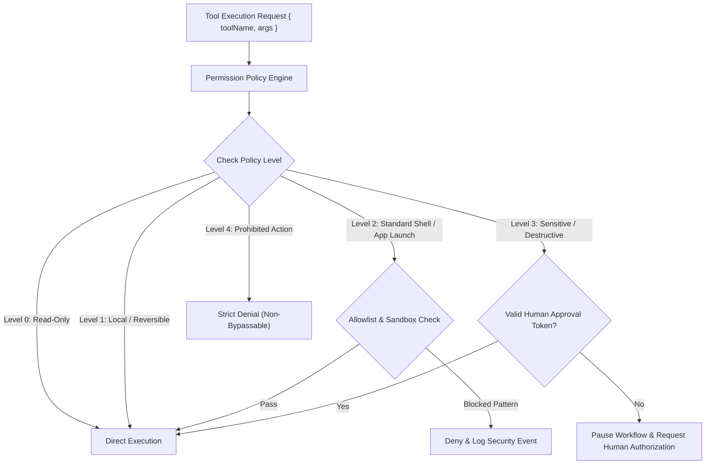

# Desktop Automation Architecture & Security Governance

JARVIS provides deep Windows desktop automation capabilities combining low-level Win32 operating system interop, Playwright headless browser control, WinRT hardware-accelerated OCR, and a strict multi-tier permission governance engine.

---

## 1. Automation Capabilities Matrix

| Subsystem | Underlying Technology | Key Modules | Verified Capabilities |
| :--- | :--- | :--- | :--- |
| **Application Launching** | Win32 API & Node `child_process` | `server/desktop/appLauncher.js`, `windowsAppRegistry.js` | Discovers 140+ installed Windows apps; resolves aliases; launches allowlisted binaries; monitors process PIDs. |
| **Window & Focus Control** | Win32 `user32.dll` via Python `ctypes` | `agent/desktop_automation.py`, `server/desktop/desktopController.js` | `EnumWindows`, `SetForegroundWindow`, `ShowWindow`, `GetWindowRect`, multi-monitor coordinate translation. |
| **Mouse & Keyboard** | Win32 `user32.dll` `SendInput` | `server/desktop/whatsapp_automator.py`, `agent/desktop_automation.py` | DPI-aware synthetic mouse movement, click dispatch, keystroke injection, interactive desktop session attachment. |
| **Browser Interaction** | Microsoft Playwright (Chromium) | `server/browser/browserAutomationEngine.js` | Headless/headed page navigation, structured article extraction, DOM scraping, form input, page screenshots. |
| **Document Generation** | Pure-Python OpenXML & PDF 1.4 | `agent/docx_generator.py`, `excel_generator.py`, `pdf_generator.py` | Generates formatted Word (.docx), Excel (.xlsx), and PDF reports with **zero third-party libraries**. |
| **Document Automation** | PowerShell COM Automation | `server/desktop/word_automator.ps1`, `liveDocumentStudio.js` | Directly attaches to running Microsoft Word instances to progressively insert text, headings, and format styles. |
| **Optical Recognition** | Windows Runtime (WinRT) OCR | `server/desktop/windows_ocr.ps1` | Uses native `Windows.Media.Ocr.OcrEngine` for offline, GPU-accelerated text extraction with bounding boxes. |
| **Screen Perception** | Pillow (`PIL.ImageGrab`) & OpenCV | `server/vision/python_vision_bridge.py` | Full-screen and bounding-box capture, multi-monitor coordinates, color detection. |
| **Task Planning** | Directed Acyclic Graph (DAG) Engine | `server/dagPlanningEngine.js`, `taskOrchestrator.js` | Decomposes multi-step user instructions into structured dependencies; checkpointing in `data/tasks/`. |
| **Conversational Memory** | Multi-Tier Context Memory | `server/memory/`, `server/memoryManager.js` | Working memory (turn state), episodic memory (task outcomes), and long-term memory with prompt injection sanitization. |

---

## 2. Multi-Tier Security & Permission Governance

To prevent accidental data loss or unauthorized execution, all actions are governed by `server/security/permissionPolicyEngine.js` and `server/desktop/permissionGate.js`:

### Policy Levels

- **Level 0 (Read-Only / Safe)**:
  - System diagnostics (`CPU`, `RAM`, `Disk`), reading files, listing windows, clock, timers.
  - Automatically executed.
- **Level 1 (Reversible Local Modifications)**:
  - Creating temporary files inside `scratch/`, staging draft notes, window focus adjustments.
  - Automatically executed.
- **Level 2 (Standard Controlled Operations)**:
  - Launching allowlisted desktop applications (`code`, `notepad`, `chrome`, `calc`, `explorer`).
  - Controlled shell commands matching strict patterns (`git status`, `node -v`, `Get-Process`).
- **Level 3 (Sensitive / Destructive Operations — Human Approval Required)**:
  - **File Deletion**: Any `delete_file` or `delete_workspace_file` outside `scratch/` requires an explicit single-use cryptographic approval token.
  - **External Communication**: Sending WhatsApp messages, dispatching emails.
  - **Code Modification**: Modifying source code or applying automated patches.
  - The workflow pauses, emits an `APPROVAL_REQUIRED` event to the user with parameter details, and awaits explicit user authorization before resuming.
- **Level 4 (Strictly Prohibited / Critical)**:
  - Deleting system-critical directories (`C:\Windows`, `C:\Program Files`).
  - Formatting disks, modifying Windows BCD/registry, modifying security controls.
  - Strictly blocked under all circumstances with zero override.

---

## 3. Shell Command Sandboxing

The local agent enforces strict regex allowlisting and denylisting in `server/desktop/windowsLocalAgent.js`:

* **Allowed Command Patterns**:
  * Diagnostics: `Get-Process`, `Get-Service`, `Get-Date`, `whoami`, `hostname`, `ipconfig`, `systeminfo`.
  * Directory Inspection: `Get-ChildItem`, `dir`, `ls`, `Get-Content`, `cat`.
  * Development Inspection: `node -v`, `npm -v`, `git status`, `git log`.
* **Blocked Command Tokens**:
  * Destructive commands: `format`, `diskpart`, `bcdedit`, `reg delete`, `takeown`, `icacls ... /deny`.
  * Mass deletion: `del /s /q C:\`, `rmdir /s /q C:\`, `Remove-Item -Recurse -Force C:\`.
  * Fork bombs and shell exploits.

---

## 4. Audit Logging & State Persistence

Every executed action is recorded with empirical proof:
1. **Audit Ledger**: Stored in `data/desktop_agent_audit.json` recording timestamp, tool name, parameters, result status, process PID, and active personality.
2. **Cryptographic Audit Trail**: Stored in `data/audit_trail.jsonl` with SHA-256 hash chaining to ensure tamper-evident records.
3. **Emergency Stop**: Pressing the emergency stop trigger immediately halts all active child processes, revokes pending approvals, and locks tool dispatching (`server/emergencyStopController.js`).
