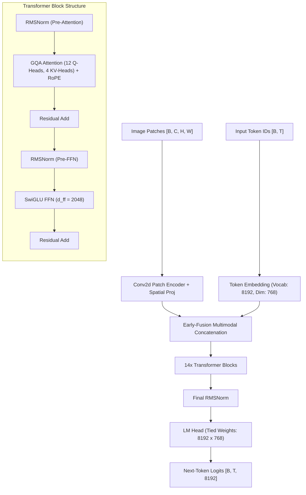

# VISION LLM — Architecture, Tokenizer & Training Specification

VISION is an independently developed, decoder-only autoregressive foundation language model implemented from scratch in PyTorch (`ml_foundation/model.py`). The project explores model scaling, tokenization, training curriculum, and local inference for edge and desktop compute.

---

## 1. Architectural Design

VISION implements a modern transformer architecture incorporating key design patterns found in contemporary open-weight LLMs:

### Key Components

1. **Rotary Position Embeddings (RoPE)**: Applied to queries and keys in each attention block with base frequency $\theta = 10000.0$. RoPE preserves relative token distances naturally without requiring learned absolute positional tables.
2. **Root Mean Square Normalization (RMSNorm)**: Replaces standard LayerNorm across all pre-attention and pre-feedforward stages, reducing computational overhead while maintaining numerical stability during low-precision execution.
3. **Grouped-Query Attention (GQA)**: Configured with 12 query heads and 4 key-value heads (a 3:1 ratio). This reduces the KV-cache memory footprint by 66% during autoregressive generation compared to standard multi-head attention.
4. **SwiGLU Activation**: Feed-forward sub-layers use the Swish-Gated Linear Unit formulation:
   $$\text{SwiGLU}(x) = (x W_{gate} \cdot \text{SiLU}(x W_{gate})) \cdot (x W_{up}) W_{down}$$
5. **Early-Fusion Multimodal Projection**: A convolutional patch encoder (`JarvisVisionPatchEncoder`) projects $8 \times 8$ visual patches directly into the transformer hidden dimension, allowing joint attention over interleaved text and image tokens.

---

## 2. Parameter Calculation (100M Baseline)

The 100M parameter preset (`vision-scale-100m`) is parameterized as follows:

| Hyperparameter | Value | Description |
| :--- | :--- | :--- |
| Hidden Dimension ($d_{model}$) | 768 | Model vector dimension |
| Number of Layers ($n_{layers}$) | 14 | Transformer blocks |
| Attention Query Heads ($n_{heads}$) | 12 | Query projections ($head\_dim = 64$) |
| Key-Value Heads ($n_{kv\_heads}$) | 4 | GQA key/value projections |
| FFN Intermediate Dimension ($d_{ff}$) | 2,048 | SwiGLU expansion dimension |
| Vocabulary Size ($vocab\_size$) | 8,192 | Custom Byte-BPE subword vocabulary |
| Maximum Sequence Length | 2,048 | Context window |

### Mathematical Parameter Breakdown

1. **Embedding Layer**:
   $$8,192 \times 768 = 6,291,456 \text{ parameters}$$

2. **Single Attention Block**:
   - Query Projection: $768 \times (12 \times 64) = 589,824$
   - Key Projection: $768 \times (4 \times 64) = 196,608$
   - Value Projection: $768 \times (4 \times 64) = 196,608$
   - Output Projection: $(12 \times 64) \times 768 = 589,824$
   - Total Attention per layer: $1,572,864 \text{ parameters}$

3. **Single SwiGLU FFN Block**:
   - Gate Projection: $768 \times 2,048 = 1,572,864$
   - Up Projection: $768 \times 2,048 = 1,572,864$
   - Down Projection: $2,048 \times 768 = 1,572,864$
   - Total FFN per layer: $4,718,592 \text{ parameters}$

4. **Normalization & Residuals**:
   - 2 RMSNorm layers per block: $2 \times 768 = 1,536 \text{ parameters}$

5. **Layer Total**:
   $$\text{Block} = 1,572,864 + 4,718,592 + 1,536 = 6,292,992 \text{ parameters}$$

6. **All 14 Layers**:
   $$14 \times 6,292,992 = 88,101,888 \text{ parameters}$$

7. **Multimodal Encoders & Heads**:
   - Vision Patch Encoder + Projections: $\sim 3,860,000 \text{ parameters}$
   - Final RMSNorm + Classification Heads: $\sim 15,000 \text{ parameters}$
   - Weight Tying: LM head shares weights with the token embedding table.

$$\text{Total Parameters} \approx 98,268,344 \text{ (\~98.3M / 100M Baseline)}$$

---

## 3. Tokenizer Implementation

The tokenizer (`ml_foundation/tokenizer.py`) is a deterministic, custom Byte-Level Byte-Pair Encoding (`JarvisBPE`) algorithm built with the following specifications:

- **Lossless Byte Representation**: Reversible mapping of all 256 raw UTF-8 bytes to unambiguous Unicode code points, guaranteeing 100% roundtrip reconstruction for arbitrary text, binary snippets, and Unicode characters.
- **Multilingual Support**: Supports English, Hindi Devanagari (`\u0900-\u097F`), and Hinglish transliterations without token fragmentation.
- **Code Preservation**: Regex pre-tokenization preserves identifiers containing underscores (e.g., `calculate_joint_torque`), camelCase tokens, operator clusters, and indentation structure.
- **Special Tokens**:
  - Boundary tokens: `<bos>`, `<eos>`, `<pad>`, `<unk>`
  - Role framing: `<sys>`, `</sys>`, `<user>`, `</user>`, `<assistant>`, `</assistant>`
  - Reasoning: `<thought>`, `</thought>`
  - Tool calling: `<|tool_call|>`, `<|/tool_call|>`, `<|tool_result|>`, `<|/tool_result|>`

---

## 4. Training Pipeline & Objective

The training engine (`ml_foundation/trainer.py`, `unified_training_pipeline.py`) provides:

1. **Loss Function**: Standard Cross-Entropy with response masking:
   $$\mathcal{L} = -\frac{1}{N} \sum_{i=1}^N \sum_{t=1}^T m_t \log P(x_t \mid x_{<t})$$
   where $m_t \in \{0, 1\}$ masks prompt and system instructions, calculating loss strictly on assistant responses and target completions.
2. **Optimizer**: Decoupled AdamW (`torch.optim.AdamW`) with weight decay of 0.1 applied strictly to 2D weight matrices (decay excluded from RMSNorm scales and 1D biases).
3. **Learning Rate Schedule**: Cosine annealing with linear warmup over the initial 5% of total optimizer steps, decaying to 10% of peak learning rate.
4. **Data Streaming**: Memory-mapped binary shards (`numpy.memmap`) enable zero-copy iteration across pre-tokenized corpora without loading entire datasets into RAM.
5. **Checkpoint Management**: Checkpoints (`weights.pt`) save full state dictionaries including `model_state_dict`, `optimizer_state_dict`, `scheduler_state_dict`, random number generator states, and training step metadata.

---

## 5. Local Inference

Autoregressive inference is implemented in `ml_foundation/inference.py`:

- **KV-Caching**: Maintains persistent Key and Value tensors across decoding steps to avoid redundant recalculations, yielding $O(1)$ attention complexity per generated token.
- **Sampling Controls**: Supports greedy decoding, temperature scaling ($T > 0$), top-$p$ nucleus filtering, and frequency/presence repetition penalties.
- **Cooperative Cancellation**: Training and inference workers support graceful cancellation flags for interactive UI responsiveness.

---

## 6. Honest Technical Limitations

As an independent research project developed on local consumer hardware:

1. **Training Scale**: Pretraining runs to date have focused on proof-of-concept verification (tens of millions of tokens) rather than industrial web-scale pretraining (hundreds of billions of tokens).
2. **Reasoning Generalization**: While the model learns specific curriculum patterns and syntactic structures, zero-shot generalization on novel complex multi-step reasoning remains limited compared to frontier commercial models.
3. **Compute Hardware**: Local training and CPU inference operate within consumer power and thermal budgets ($0.00 cloud compute).
4. **Dual-Model Architecture**: For production conversational assistance and complex system tasks, the desktop assistant leverages the Google Gemini REST integration alongside VISION.
