# STARK AI / J.A.R.V.I.S. — PHASE 7 PREFLIGHT AUDIT

## Agentware Trap Pack & Adversarial Hardening

**Date:** November 8, 2026  
**Phase:** 7 Preflight  
**Objective:** Subject the complete STARK AI system (Central Orchestrator, 7 Specialist Agents, DAG Execution Engine, Browser Engine, Local Desktop Agent, Permission Policy Engine, Audit Trail) to an exhaustive adversarial test battery simulating real-world attacker exploits, hackathon evaluation traps, and adversarial injections.

---

### 1. The 10 Agentware Adversarial Traps

```mermaid
graph TD
    subgraph "Adversarial Attack Vectors (Agentware Trap Pack)"
        T1["Trap 1: Indirect Web Injection (Hidden HTML/CSS)"]
        T2["Trap 2: Malicious Ingested Document (.docx/PDF)"]
        T3["Trap 3: Credential Theft & Exfiltration (SSRF/Logs)"]
        T4["Trap 4: Privilege Escalation & Self-Approval"]
        T5["Trap 5: Cycle Injection & Recursive Plan Bomb"]
        T6["Trap 6: Cloud Metadata / Internal SSRF Probe"]
        T7["Trap 7: Shell Operator Command Chaining (; / & / |)"]
        T8["Trap 8: Destructive Core Asset & Log Tampering"]
        T9["Trap 9: False Success Attribution (Missing Evidence)"]
        T10["Trap 10: Emergency Stop Bypass & Latched Execution"]
    end

    subgraph "STARK AI Defense Layers"
        D1["XML Content Sandbox (<untrusted_content>)"]
        D2["5-Tier Permission Policy Engine (Levels 0-4)"]
        D3["SSRF Destination Validator & IP Subnet Filter"]
        D4["Acyclic Kahn DAG Validator"]
        D5["Independent Verifier (AST & SHA-256)"]
        D6["Emergency Stop Hardware Latch"]
        D7["Cryptographic Append-Only Audit Chain"]
    end

    T1 --> D1
    T2 --> D1
    T3 --> D3
    T4 --> D2
    T5 --> D4
    T6 --> D3
    T7 --> D2
    T8 --> D2
    T9 --> D5
    T10 --> D6
```

---

### 2. Preflight Subsystem Readiness

| Subsystem | Existing File | Hardening Required for Phase 7 | Status |
| :--- | :--- | :--- | :--- |
| **Adversarial Engine** | `server/verificationAdversarialEngine.js` | Expand threat patterns to cover indirect injection, zero-font CSS, base64 payloads, and tool fuzzing | Ready to expand |
| **Permission Policy Engine** | `server/security/permissionPolicyEngine.js` | Verify Level 0–4 denials under adversarial argument fuzzing and token forgery | Verified in Phase 4; to be stressed |
| **Browser Engine** | `server/browser/browserAutomationEngine.js` | Enforce HTML sanitization and untrusted data wrapping on page extraction | Verified in Phase 3; to be stressed |
| **Independent Verifier** | `server/independentVerifier.js` | Ensure 100% false-success rejection across all 10 verification methods | Verified in Phase 2; to be stressed |
| **Emergency Stop Controller** | `server/emergencyStopController.js` | Verify immediate termination under active adversarial chaos loops | Verified in Phase 5; to be stressed |
| **Multi-Agent Message Bus** | `server/multiAgentMessageBus.js` | Verify privilege escalation blocking under spoofed agent headers | Verified in Phase 6; to be stressed |

---

### 3. Next Steps

1. Create `server/security/adversarialTrapPack.js` with structured test fixtures and harness.
2. Implement `test_agentware_trap_pack_adversarial_suite.js` covering Traps 1 through 10.
3. Validate 100% defense without degrading baseline functionality.
4. Execute full 16-suite regression matrix (721 baseline + Phase 7 assertions).
