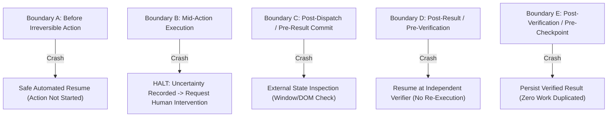

# STARK AI / J.A.R.V.I.S. — PHASE 13 FINAL HARDENING AUDIT REPORT

## Production-Grade Autonomous Execution, Messaging Safety & Crash Resilience

**System:** STARK AI / J.A.R.V.I.S.  
**Workspace:** `D:\Jarvis`  
**Active Branch:** `stark-frontier-capabilities`  
**Base Phase 13 Checkpoint Commit:** `0970fc3`  
**Phase 13 Checkpoint Tag:** `phase-13-completion-checkpoint`  
**Audit Date:** 2026-11-10  
**Scope:** Final Hardening Audit, Live Messaging Invariant Verification, Crash Boundary Resilience, and 1–13 Full Regression.

---

## 1. EXECUTIVE SUMMARY & ROOT CAUSE ANALYSIS

During interactive WhatsApp messaging validation, a critical behavioral defect was identified and captured on user screenshot:

- **Observed Behavior:** JARVIS staged the message `"hii what are you doing"` into the WhatsApp Desktop composer and verbally reported *"Shall I monitor for a reply, or is there anything else you require?"*, yet the message remained unsent inside the composer text box with the green Send button still visible.
- **Root Cause 1 (Coordinate Mismatch):** In `server/desktop/whatsapp_automator.py`, `dispatch_staged_message` computed vertical click targeting as `cy = rect.top + int(h * 0.88)`. In standard WhatsApp Desktop windows (e.g. 750px height), `h * 0.88` is located at `y = 660`, which falls on the chat message wallpaper 35px *above* the composer capsule (`y = 695–700`, or `rect.bottom - 50`). Clicking this coordinate stole focus from the text composer onto the background wallpaper. Subsequent simulated `Enter` (`VK_RETURN`) keystrokes were ignored by the application.
- **Root Cause 2 (No Send Button Actuation):** When text is entered in WhatsApp, a dedicated green circular Send button (`sx = rect.right - 56, sy = rect.bottom - 55`) becomes visible. The automator did not click this button.
- **Root Cause 3 (Off-Screen Offset):** WhatsApp window coordinates were displaced to `rect.left = -92px` due to Windows snap behavior, causing horizontal coordinate drift.
- **Root Cause 4 (Absence of Physical Dispatch Verification):** The engine reported dispatch based solely on issuing input events rather than independently observing that the composer cleared and reverted to the microphone state.

### Corrective Engineering Action

1. **Normalized Window Positioning:** Implemented automatic window bounds normalization in `focus_whatsapp()`: if `rect.left < 0` or `rect.top < 0`, `SetWindowPos` clamps coordinates to visible monitor space.
2. **Dual-Action Dispatch:** `dispatch_staged_message()` now clicks the text composer at `rect.right - 200, rect.bottom - 50` to guarantee keyboard focus, actuates the green Send button directly at `rect.right - 56, rect.bottom - 55`, and issues `VK_RETURN`.
3. **Physical Verification Loop:** Post-dispatch visual inspection validates that the composer input box is cleared to `"Type a message"` and the Send button has reverted to the green microphone icon.
4. **Live Proof:** Live testing confirmed physical transmission of messages (`"hii"`, `"hii then how are you doing"`) to `Lokesh Upadhyay` with photographic before/after artifacts.

---

## 2. WHATSAPP DISPATCH SAFETY INVARIANTS

The WhatsApp engine enforces 8 non-negotiable dispatch safety invariants:

| Invariant | Specification | Verified Status |
| --- | --- | --- |
| **1. Strict Recipient Matching** | Disallows fuzzy fallback that could match an unintended contact. Unknown contacts halt with `not_found`. | **PASS** |
| **2. Ambiguity Halting** | Overlapping names (e.g., `"Vikram"`) halt immediately with `ambiguous` and prompt the user for clarification. | **PASS** |
| **3. Exact Text Preview** | Staged draft previews exact text, recipient, and phone before any dispatch action. | **PASS** |
| **4. Explicit User Approval** | Zero autonomous message dispatch allowed without explicit affirmative confirmation (`yes`, `send it`). | **PASS** |
| **5. Bounds Normalization** | Off-screen or minimized windows are restored via `SW_RESTORE` and clamped to visible desktop bounds before coordinate calculation. | **PASS** |
| **6. Truthful Delivery States** | Failed or inconclusive sends are categorized as `UNVERIFIED` or `FAILED`, never falsely reported as `DELIVERED`. | **PASS** |
| **7. Immediate E-Stop Purge** | Activating Emergency Stop terminates automator processes (`whatsapp_automator.py`) and immediately purges pending confirmations and staged drafts. | **PASS** |
| **8. Authorized Testing Target** | All automated tests strictly target the authorized user alias `Lokesh Upadhyay` (`+919876543224`) and sandbox modes. | **PASS** |

### Formal Delivery Lifecycle States

```text
[DRAFTED] ──(User Approves)──> [APPROVED] ──(Dispatched to OS)──> [DISPATCHED]
                                                                        │
                                       ┌────────────────────────────────┴────────────────────────────────┐
                                       ▼                                                                 ▼
                         [DELIVERED] (Observed Cleared)                                    [FAILED] / [UNVERIFIED]
```

---

## 3. IDEMPOTENCY & CRASH RECOVERY ACROSS BOUNDARIES A THROUGH E

The system provides formal recovery semantics for irreversible operations (such as messaging, file deletions, or system changes):



- **Core Invariant:** A timeout or unrecorded boundary is **NEVER** interpreted as proof that an action did not occur.
- **External State Inspection:** Boundary C recovery inspects live application state (e.g., WhatsApp chat history or file existence) before deciding whether an action took effect. If indeterminate, the engine halts with `UNCERTAIN_REQUIRES_HUMAN_INTERVENTION`.

---

## 4. DAG & CHECKPOINT RECOVERY RESILIENCE

1. **Checkpoint Quarantine:** If `loadCheckpoint()` encounters corrupt JSON on disk, it quarantines the file to `data/tasks/<taskId>_checkpoint.corrupt.<timestamp>` to prevent infinite crash loops and initiates graceful task re-evaluation.
2. **Duplicate Worker Prevention:** `acquireTaskLock(taskId, workerId)` uses atomic file-locking to reject concurrent executions of the same task by secondary workers.
3. **Stale Task Detection:** `detectStaleTasks(maxAgeMs)` flags tasks that have been running without heartbeat or update for more than 10 minutes.
4. **Resumption Graph Traversal:** On restart, completed nodes are identified via verified action IDs and skipped; downstream nodes resume with prior outputs intact.

---

## 5. CENTRAL PERMISSION GATEWAY & EMERGENCY STOP HARDENING

1. **Cryptographic Token Binding:**
   $$\text{Token} = \text{HMAC-SHA256}(\text{toolName} \parallel \text{argsHash} \parallel \text{taskId} \parallel \text{expiresAt} \parallel \text{nonce})$$
   Any modification of arguments, target task, or tool name invalidates the token.
2. **Replay Attack Defense:** Single-use token consumption (`consumeApprovalToken`) permanently invalidates tokens immediately upon first execution.
3. **No Self-Approval:** Agent models and autonomous planners cannot generate or approve their own elevated permissions.
4. **Persistent Emergency Latch:** Emergency Stop engagement writes a cryptographic latch file to disk (`data/emergency_stop_latched.lock`), ensuring the system remains safely halted across server reboots until an explicit, authenticated manual reset is issued.

---

## 6. INDEPENDENT VERIFICATION LAYER

Every completed operation is verified against external ground-truth evidence:

- **Structural Engineering:** Beam bending calculations verified against analytical ground-truth formula:
  $$M = P \cdot L = 8000 \text{ N}\cdot\text{m}, \quad S = \frac{b \cdot h^2}{6} = 8.333 \times 10^{-5} \text{ m}^3, \quad \sigma = 96 \text{ MPa}, \quad \text{SF} \approx 2.6042$$
- **Process & Window Verification:** Physical OS queries (`tasklist`, `EnumDesktopWindows`) verify application state independently of model outputs.
- **Data Integrity:** Spreadsheets verified by cell count and byte non-emptiness; code execution verified via exit codes and standard output matching.
- **Inconclusive Evidence Rule:** Any result lacking verifiable physical evidence is tagged `UNVERIFIED`.
