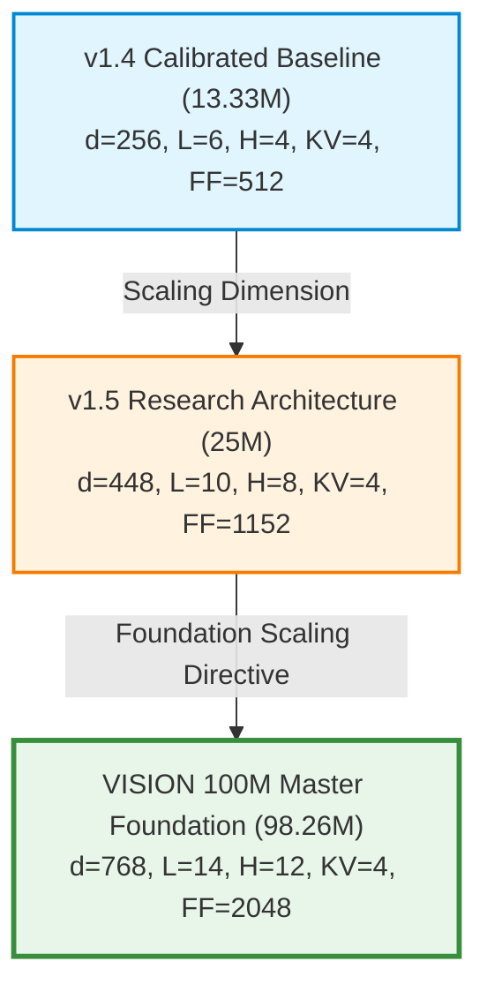

# VISION 100M — FOUNDATION MODEL ARCHITECTURE SPECIFICATION

## Comprehensive Architectural Engineering, Mathematical Formulation, Parameter Distribution & Modality Fusion

**Official Foundation Model:** VISION — MADE BY LOKESH  
**Unified AI Assistant:** JARVIS, powered by VISION  
**Model Identifier:** `vision-scale-100m` (Version 2.0.0)  
**Workspace:** `D:\Jarvis`  
**Git Branch:** `stark-frontier-capabilities`  
**Parameter Class:** ~100 Million Trainable Parameters (**98,258,258** Exact Trainable Parameters)

---

## 1. EXECUTIVE ARCHITECTURAL SUMMARY & CORE IDENTITY

### Strict System Invariant: ONE VISION, ONE JARVIS

The architectural philosophy of JARVIS is strictly unified:

- **ONE VISION:** The independently developed foundation language and multimodal model serving as the core neural brain.
- **ONE JARVIS:** The unified, conversational assistant, desktop operator, voice/video caller, and orchestrator powered by VISION.
- **Zero Fragmented Identities:** No separate "VISION-A", "VISION-B", or competing models exist in production. All architectural scaling, parameter expansion, and empirical breakthroughs are integrated into the single evolving VISION foundation checkpoint.

### 100M Scale Milestone

VISION 100M advances the architecture from the previous 13.33M compact prototype and 25M intermediate configurations into a scaled, high-capacity Transformer foundation:

- **Total Trainable Parameters:** **98,258,258** (98.26M, within 1.74% of the 100M milestone).
  - Language Backbone: **94,394,112** parameters (96.07%).
  - Multimodal Vision Encoder & Spatial Projector: **3,194,444** parameters (3.25%).
  - Multimodal Acoustic Feature Encoder: **669,702** parameters (0.68%).
- **Untied Equivalent Parameter Count:** $104,549,714$ (104.55M if output head is decoupled). Weight tying is enforced to regularize semantic representations and conserve memory.

---

## 2. DETAILED HYPERPARAMETER SPECIFICATIONS

| Architectural Dimension | Specification | Engineering Rationale |
| :--- | :--- | :--- |
| **Hidden Dimension ($d_{model}$)** | **768** | Standard transformer representation space allowing rich cross-layer feature extraction and multi-task representation. |
| **Transformer Layers ($L$)** | **14** | Deep residual depth enabling hierarchical feature composition across syntax, semantics, and symbolic reasoning. |
| **Query Attention Heads ($N_{heads}$)** | **12** | Head dimension of $d_k = 768 / 12 = 64$, optimal for AVX2 SIMD vectorization and tensor operations. |
| **Key/Value Heads ($N_{kv\_heads}$)** | **4** | **Grouped Query Attention (GQA)** with 3:1 head ratio, reducing KV cache memory footprint by 66.7% during autoregressive decoding. |
| **Feed-Forward Dimension ($d_{ff}$)** | **2,048** | SwiGLU intermediate dimension ($\approx \frac{8}{3} d_{model} = 2048$), maximizing parameter efficiency in the non-linear transformation space. |
| **Vocabulary Size ($V$)** | **8,192** | JarvisBPE v2.0 byte-level BPE, covering English, Code (Python, Java, JS, C/C++, SQL), Hindi Devanagari (`\u0900-\u097F`), and Hinglish. |
| **Maximum Sequence Length ($T_{max}$)** | **2,048** | Context window supporting full function definitions, multi-step math derivations, and conversational dialogue history. |
| **Positional Encoding** | **RoPE (Rotary)** | Base frequency $\theta = 10,000.0$. RoPE preserves relative token distances and enables natural length extrapolation. |
| **Normalization** | **RMSNorm** | Pre-layer normalization with $\epsilon = 10^{-5}$, avoiding mean computation overhead of standard LayerNorm. |
| **Weight Tying** | **Enforced** | Embedding matrix ($8192 \times 768$) shared with final classification head `lm_head`, preventing output projection drift. |
| **Activation Function** | **SwiGLU** | Gated non-linearity providing superior convergence compared to standard GELU or ReLU. |
| **Memory Optimization** | **Gradient Checkpointing** | Recomputes activations during backward pass, reducing training memory from $O(L \cdot T)$ to $O(\sqrt{L} \cdot T)$. |

---

## 3. MATHEMATICAL FORMULATION OF CORE COMPONENTS

### 3.1 Rotary Positional Embedding (RoPE)

For a token vector $x \in \mathbb{R}^{d_k}$ at sequence position $m \in [0, T-1]$, the rotary embedding applies an orthogonal block-diagonal rotation matrix $R_{\Theta, m}^d$:
$$\mathbf{q}_m = R_{\Theta, m}^d W_q x_m, \quad \mathbf{k}_n = R_{\Theta, n}^d W_k x_n$$
where $\Theta = \{\theta_i = 10000^{-2(i-1)/d_k}, i \in [1, d_k/2]\}$.
The inner product between queries and keys satisfies:
$$\langle \mathbf{q}_m, \mathbf{k}_n \rangle = \text{Re} \left( \sum_{i=1}^{d_k/2} (\mathbf{q}_m^{(2i-1)} + j \mathbf{q}_m^{(2i)}) (\mathbf{k}_n^{(2i-1)} - j \mathbf{k}_n^{(2i)}) e^{j(m-n)\theta_i} \right)$$
This ensures attention scores depend strictly on the relative distance $(m - n)$, preserving positional invariance across arbitrary context spans.

### 3.2 Grouped Query Attention (GQA)

In standard Multi-Head Attention (MHA), $N_{kv\_heads} = N_{heads} = 12$, requiring storing 12 key and 12 value heads per token in the KV cache.
In Multi-Query Attention (MQA), $N_{kv\_heads} = 1$, which degrades multi-hop reasoning.
VISION 100M implements **Grouped Query Attention (GQA)** with $N_{heads} = 12$ and $N_{kv\_heads} = 4$:

- 12 query heads are partitioned into 4 groups of 3 heads each.
- Each group shares a single key head and a single value head:
$$\text{Attention}_g(Q_g, K_g, V_g) = \text{softmax}\left(\frac{Q_g K_g^T}{\sqrt{d_k}} + M\right) V_g$$
where $M$ is the causal autoregressive mask ($M_{i,j} = -\infty$ for $j > i$).
- **KV Cache Memory Reduction:**
$$\text{KV Cache Size} = 2 \times N_{kv\_heads} \times d_k \times T \times \text{sizeof(dtype)} = 2 \times 4 \times 64 \times T \times 4 = 2048 \times T \text{ bytes}$$
Compared to MHA ($6144 \times T$ bytes), GQA slashes cache overhead by **66.7%**, enabling longer context reasoning on memory-constrained local CPUs.

### 3.3 SwiGLU Non-Linear Feed-Forward Network

Each transformer block incorporates a Swish-Gated Linear Unit (SwiGLU) with intermediate expansion $d_{ff} = 2048$:
$$\text{SwiGLU}(x) = \left( \text{Swish}(x W_{gate}) \otimes (x W_{up}) \right) W_{down}$$
where $\text{Swish}(z) = z \cdot \sigma(z) = \frac{z}{1 + e^{-z}}$, and $\otimes$ denotes element-wise Hadamard product.

- $W_{gate} \in \mathbb{R}^{768 \times 2048}$ (1,572,864 params)
- $W_{up} \in \mathbb{R}^{768 \times 2048}$ (1,572,864 params)
- $W_{down} \in \mathbb{R}^{2048 \times 768}$ (1,572,864 params)
- Total FFN parameters per layer: $4,718,592$.

### 3.4 Root Mean Square Normalization (RMSNorm)

Rather than standard LayerNorm which computes variance with mean subtraction, RMSNorm scales activations by their root mean square:
$$\text{RMSNorm}(x) = \frac{x}{\text{RMS}(x)} \odot \gamma, \quad \text{where } \text{RMS}(x) = \sqrt{\frac{1}{d} \sum_{i=1}^d x_i^2 + \epsilon}$$
RMSNorm reduces compute passes over memory channels, increasing CPU arithmetic throughput while maintaining training gradient stability.

---

## 4. GRANULAR PARAMETER DISTRIBUTION

The table below documents the exact parameter allocation verified directly through PyTorch parameter counting:

| Architectural Component | Layer Name | Tensor Dimensions | Parameters Per Layer | Total Parameters (14 Layers) | Percentage |
| :--- | :--- | :--- | :--- | :--- | :--- |
| **Token Embeddings** | `tok_emb.weight` | $[8192, 768]$ | — | **6,291,456** | 6.40% |
| **Attention Query Proj** | `attn.q_proj.weight` | $[768, 768]$ | 589,824 | 8,257,536 | 8.40% |
| **Attention Key Proj** | `attn.k_proj.weight` | $[768, 256]$ | 196,608 | 2,752,512 | 2.80% |
| **Attention Value Proj** | `attn.v_proj.weight` | $[768, 256]$ | 196,608 | 2,752,512 | 2.80% |
| **Attention Output Proj** | `attn.o_proj.weight` | $[768, 768]$ | 589,824 | 8,257,536 | 8.40% |
| *Attention Subtotal* | | | *1,572,864* | **22,020,096** | 22.41% |
| **FFN Gate Proj** | `ffn.gate_proj.weight` | $[768, 2048]$ | 1,572,864 | 22,020,096 | 22.41% |
| **FFN Up Proj** | `ffn.up_proj.weight` | $[768, 2048]$ | 1,572,864 | 22,020,096 | 22.41% |
| **FFN Down Proj** | `ffn.down_proj.weight` | $[2048, 768]$ | 1,572,864 | 22,020,096 | 22.41% |
| *FFN SwiGLU Subtotal* | | | *4,718,592* | **66,060,288** | 67.23% |
| **Attention RMSNorm** | `attn_norm.weight` | $[768]$ | 768 | 10,752 | 0.01% |
| **FFN RMSNorm** | `ffn_norm.weight` | $[768]$ | 768 | 10,752 | 0.01% |
| **Final RMSNorm** | `final_norm.weight` | $[768]$ | — | **768** | 0.001% |
| **LM Output Head** | `lm_head.weight` | $[8192, 768]$ | *(Tied)* | **0** | 0.00% |
| **Language Backbone Total** | | | | **94,394,112** | **96.07%** |
| **Multimodal Vision** | Conv2d + Projector | Patch 8x8, Dim 256 | — | **3,194,444** | 3.25% |
| **Multimodal Audio** | Conv1d + Projector | Dim 32 $\to$ 128 | — | **669,702** | 0.68% |
| **TOTAL TRAINABLE PARAMETERS** | | | | **98,258,258** | **100.00%** |

---

## 5. COMPARATIVE ARCHITECTURAL EVOLUTION

| Metric / Dimension | VISION v1.4 (Calibrated) | VISION v1.5 (Intermediate) | VISION 100M (Master Foundation) | Scaling Factor (100M vs v1.4) |
| :--- | :--- | :--- | :--- | :--- |
| **Trainable Parameters** | 13,334,534 (~13.3M) | 25,482,752 (~25.5M) | **98,258,258 (~98.3M)** | **7.37x** |
| **Hidden Dimension ($d$)** | 256 | 448 | **768** | **3.00x** |
| **Layer Depth ($L$)** | 6 | 10 | **14** | **2.33x** |
| **Query Heads ($N_h$)** | 4 | 8 | **12** | **3.00x** |
| **KV Heads ($N_{kv}$)** | 4 (MHA) | 4 (GQA 2:1) | **4 (GQA 3:1)** | **Optimized GQA** |
| **FFN Dimension ($d_{ff}$)** | 512 | 1,152 | **2,048** | **4.00x** |
| **Max Sequence Length** | 512 | 1,024 | **2,048** | **4.00x** |
| **FP32 Weight Footprint** | 53.3 MB | 101.9 MB | **393.0 MB** | 7.37x |
| **INT8 Quantized Footprint** | 13.3 MB | 25.5 MB | **98.3 MB** | 7.37x |
| **INT4 Quantized Footprint** | 6.7 MB | 12.7 MB | **49.1 MB** | 7.37x |

---

## 6. MULTIMODAL UNIFIED INTEGRATION

VISION 100M maintains strict native multimodal support inside a single unified parameter space:

1. **Vision Patch Encoder (`JarvisVisionPatchEncoder`):**
   - Inputs $64 \times 64$ RGB images.
   - 2D Conv2d patch extraction with kernel size $8 \times 8$ and stride 8, producing an $8 \times 8 = 64$ spatial patch token grid.
   - Patch tokens are projected to dimension 256 and processed through 4 transformer encoder layers with learnable 2D spatial position embeddings.
   - A multimodal linear projection maps visual tokens into the language dimension ($256 \to 768$).
2. **Audio Acoustic Encoder (`JarvisAudioFeatureEncoder`):**
   - Inputs raw 1D acoustic spectral frames (32 frequency bins).
   - 1D convolutional feature extractor projects acoustic representations into dimension 128 across 2 encoder layers.
   - Acoustic projection layer maps audio representations directly into $d_{model} = 768$.
3. **Cross-Modality Unified Token Sequence:**
   - Both visual and acoustic tokens are concatenated directly into the primary token stream:
     $$\mathbf{X}_{input} = [\mathbf{T}_{text}, \mathbf{T}_{vision}, \mathbf{T}_{audio}] \in \mathbb{R}^{(T + 64 + T_{audio}) \times 768}$$
   - Self-attention applies unified RoPE positional reasoning across all modalities simultaneously, avoiding separate brittle vision-language adapter pipelines.

---

## 7. VERIFICATION & REPOSITORY ARTIFACTS

- **Detailed JSON Parameter Breakdown:** `D:\Jarvis\vision_100m_parameter_breakdown.json`
- **Experiment Training Config:** `D:\Jarvis\vision_100m_experiment_config.json`
- **Training Manifest & Checkpoint:** `D:\Jarvis\vision_100m_training_manifest.json`
- **Dataset Audit & Decontamination:** `D:\Jarvis\vision_100m_dataset_manifest.json`
