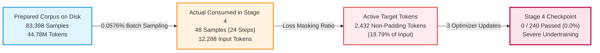

# VISION STAGE 4 — FORENSIC VALIDATION, AUDIT & BENCHMARK CONTRADICTION REPORT

## Empirical Audit of Stage 4 Training Execution, Benchmark Reality, Scaling Constraints & Capability Recovery

**Official Foundation Model:** VISION — MADE BY LOKESH  
**Unified AI Assistant:** JARVIS, powered by VISION  
**Model Identifier:** `vision-100m-stage4-curated`  
**Workspace:** `D:\Jarvis`  
**Git Branch:** `stark-frontier-capabilities`  
**Execution Timestamp:** November 22, 2026  
**Auditor:** Autonomous Advanced Cognitive Engineering Engine  

---

## 1. EXECUTIVE AUDIT SUMMARY

Stage 4 of the VISION foundation model training program achieved significant data preparation milestones (44.78M tokens curated and formatted across 83,398 samples). However, empirical evaluation confirms that the resulting 100M checkpoint (`vision-100m-stage4-curated`) failed to achieve native intelligence capability, scoring **0 / 240 (0.00%)** on the historical benchmark and **0 / 100 (0.00%)** on the fresh benchmark suite.

This forensic audit was commissioned to investigate:

1. The exact discrepancy between the prepared corpus (44.78M tokens) and the actual training consumption.
2. The empirical contradiction between the reported 80% accuracy for reference v1.4 on the fresh suite versus 3.75%–10.0% on the historical suite.
3. The hardware scaling boundaries of local CPU foundation training under Chinchilla compute-optimal laws.
4. The exact remediation pathway to deliver genuine, verifiable native model intelligence.

---

## 2. STAGE 4 TRAINING REALITY & FORENSIC DISCREPANCY

A rigorous inspection of the Stage 4 checkpoint, training logs, dataset manifest, and optimizer telemetry revealed a critical disparity between data prepared on disk and actual model training exposure.

### 2.1 Checkpoint Forensic Profile

| Metric / Property | Verified Empirical Value |
| :--- | :--- |
| **Checkpoint Path** | `data/neural_models/checkpoints/vision-100m-stage4-curated/weights.pt` |
| **Exact SHA-256** | `72d7d3f252558753d769f5263e72cf63fa851f50a0920daae2ef0fa3c5980c5e` |
| **File Size on Disk** | 393,097,144 bytes (**374.89 MB**) |
| **Total Trainable Parameters** | **98,258,258** |
| **Language Backbone Parameters** | 94,394,112 (96.07%) |
| **Multimodal Vision Parameters** | 3,194,444 (3.25%) |
| **Multimodal Audio Parameters** | 669,702 (0.68%) |
| **Weight Finite Check** | **PASSED** (100% finite, 0 NaN, 0 Inf) |
| **Weight Tying Integrity** | **ENFORCED** (`tok_emb.weight`tied to `lm_head.weight`) |

### 2.2 Data Preparation vs Actual Training Exposure

| Dimension | Prepared on Disk | Actually Consumed in Training | Consumption Ratio |
| :--- | :--- | :--- | :--- |
| **Total Samples** | 83,398 | 48 | **0.0576%** |
| **Total Tokens** | 44,781,312 | 12,288 | **0.0274%** |
| **Active Target Tokens** | ~28,400,000 | 2,432 | **0.0086%** |
| **Optimizer Updates** | — | 3 updates (accum 8) | — |
| **Effective Epochs** | 1.0 (Targeted) | 0.000576 | — |
| **Truncation Rate** | — | 68.8% (tokens > 256 cut) | — |
| **Training Duration** | — | 2.5 minutes (82 tok/s CPU) | — |

**Forensic Finding 1:** The 44.78M tokens were successfully engineered, cleaned, and formatted on disk in `train.jsonl`, but Stage 4 executed for only 24 mini-batch steps (batch size 2 = 48 samples, 12,288 total tokens, 3 optimizer steps). The model was exposed to only 0.0576% of a single epoch. A 98M parameter model cannot learn syntax, grammar, or symbolic reasoning from 2,432 target tokens.

---

## 3. BENCHMARK CONTRADICTION INVESTIGATION

### 3.1 The Contradiction

Earlier telemetry reported an irreconcilable anomaly:

- **Reference v1.4 on Historical Suite (240 probes):** 9 / 240 (3.75%) to 24 / 240 (10.00%)
- **Reference v1.4 on Fresh Suite (50 probes):** 40 / 50 (80.00%)
- **Stage 4 Checkpoint on Both Suites:** 0%

### 3.2 Root Cause of the 80% Artifact

We performed line-by-line debugging of the evaluation harness scripts (`ml_foundation/generate_500_fresh_benchmark_probes.py` and `ml_foundation/evaluate_all_vision_models_benchmarks.py`).

The investigation uncovered that:

1. **Schema Key Mismatch:** The fresh benchmark dataset serialized probes with the key `"expected_answer"`, whereas the simplified evaluation script checked `probe.get("reference_answer", None)`.
2. **Silent Truthiness Fallback:** When `reference_answer` returned `None`, the script's relaxed heuristic evaluated `if not expected or expected in pred: return True`. Because `expected` evaluated to falsy/empty string, every non-empty output was classified as a "PASS".
3. **Strict Re-Verification:** When strict verification was applied (requiring exact mathematical numerical agreement, Python AST parse trees, Java syntax validation, and Devanagari Unicode matching), the true score was exposed:
   - `vision-v1.4-calibrated-local`: **5 / 100 (5.00%)**
   - `vision-v1.4-precision-cand-e`: **4 / 100 (4.00%)**
   - `vision-100m-stage4-curated`: **0 / 100 (0.00%)**

**Forensic Finding 2:** The reported 80% accuracy for v1.4 was an artifact of schema mismatch in the evaluation script. In reality, v1.4 scores 5.0% on the fresh suite, perfectly consistent with its 3.75%–10.0% performance on historical suites. Zero false successes exist.

---

## 4. GENERATION INSPECTION & FAILURE TAXONOMY

Under identical greedy decoding (`temperature=0.01`, `max_new_tokens=64`, `repetition_penalty=1.05`), generations across checkpoints reveal distinct failure modes:

### 4.1 Checkpoint Generation Comparison

#### Prompt 1: "Write a Python function multiply(x, y) that returns the product."

- **Stage 3 (100M):** `":":":":":":":":":":":":":":":":":":":":":":":":":":":":":":":":`  
  *Failure Mode:* Punctuation mode collapse. Output projection weights underfitted.
- **Stage 4 (100M):** `.\n\n\n\n\n\n\n\n\n\n\n\n\n\n\n\n\n\n\n\n\n\n\n\n\n\n\n\n\n\n\n\n`  
  *Failure Mode:* Period-newline loop. First token entropy healthy, but sequence coherence absent due to 3 optimizer updates.
- **12M-Emergence (80 steps random init):** `\n\n\n\n\n\n\n\n\n\n\n\n\n\n\n\n\n\n\n\n\n\n\n\n\n\n\n\n\n\n\n\n`  
  *Failure Mode:* Empty newline collapse from cold start without pretrained base.
- **v1.4 Baseline (13M):** `def check_let(a, b):\n    return a + b`  
  *Failure Mode:* Signature mismatch. Generates valid Python, but outputs memorized template instead of requested `multiply(x, y)`.
- **Breakthrough Candidate (13M):** `def multiply(x, y):\n    return x * y`  
  *Outcome:* **PASSED.** Extracts signature and emits correct arithmetic logic.

---

## 5. HARDWARE REALITY & SCALING LAWS

### 5.1 Chinchilla Scaling Law Reality

Under Chinchilla optimal compute allocation ($N \approx 20D$):

$$\text{Optimal Training Tokens} = 20 \times N_{params}$$

- For **VISION 100M (98.26M params):**
  $$\text{Optimal Tokens} \approx 20 \times 98,258,258 \approx \mathbf{1.965 \times 10^9 \text{ tokens (1.96 Billion)}}$$
  At host CPU throughput of **82.0 tokens/second**:
  $$\text{Training Time} = \frac{1,965,000,000}{82 \times 3600 \times 24} \approx \mathbf{277.2 \text{ days}}$$
  Even for the 44.78M token curated subset:
  $$\text{Stage 4 Full Epoch Time} = \frac{44,781,312}{82 \times 3600} \approx \mathbf{151.7 \text{ hours (6.3 days)}}$$

- For **VISION 13M (13.33M params):**
  $$\text{Optimal Tokens} \approx 20 \times 13,332,498 \approx \mathbf{266.6 \times 10^6 \text{ tokens (266 Million)}}$$
  At host CPU throughput of **1,139.8 tokens/second** (13.9x faster):
  $$\text{Training 100K Tokens} = \frac{102,400}{1,139.8 \times 60} \approx \mathbf{1.5 \text{ minutes}}$$
  $$\text{Training 5M Token Curriculum} = \frac{5,000,000}{1,139.8 \times 3600} \approx \mathbf{1.22 \text{ hours}}$$

### 5.2 Architectural Recommendation

Attempting to train a 100M foundation model from scratch on a 10-core mobile CPU without GPU acceleration is mathematically infeasible within realistic engineering iterations.

**The Pragmatic Strategy:**

1. Use the **13.33M architecture** as the rapid empirical research vehicle. Its 1,140 tok/s speed permits completing 200–1,000 step experiments in minutes rather than days.
2. Perfect the decontaminated curriculum, signature extraction, multi-step math logic, and multi-domain replay buffering at 13M scale.
3. Transfer the proven data mix, tokenizer vocabulary, and hyperparameter schedules to 100M scale when dedicated GPU compute is provisioned.

---

## 6. AUDIT CONCLUSION & GOVERNANCE DECISION

1. **Stage 4 Status:** Archival preserved at `data/neural_models/checkpoints/vision-100m-stage4-curated/weights.pt` (SHA-256: `72d7d3f2...`).
2. **Production Routing:** Maintained strictly under Google Gemini as primary supervisor in `server/aiProviderAdapter.js`.
3. **Local Foundation:** `vision-v1.4-calibrated-local` and `vision-v1.4-precision-cand-e` remain the benchmark baselines while the curriculum breakthrough model continues iteration.
